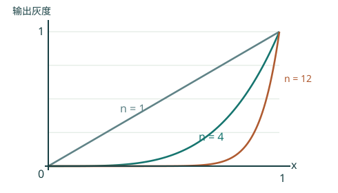

# 每个位置都有预测，整幅图会成什么样

一个滤镜把灰度 $x\in[0,1]$ 改成 $x^2$。在原灰度上再尝试更强的版本 $x^3,x^4,\ldots$。数轴上的位置现在都固定，把第 $n$ 版记作 $f_n(x)=x^n$。取 $x=1/2$，灰度迅速变暗；取 $x=0.99$，开始变化很慢，也终究会暗下去，因为 $0<x<1$ 时可写 $x=1/(1+a)$、$a>0$，用 $(1+a)^n\ge 1+na$ 就把 $x^n$ 压到趋零的上界之下；$x=0$ 直接成立。唯独 $x=1$ 永远是纯白。

先钉住一个位置，再看这个位置上的数列，便得到**逐点收敛**。精确地说，对于每个 $x$ 和每个 $\varepsilon>0$，存在可依赖 $x,\varepsilon$ 的 $N$，使 $n\ge N$ 时 $|f_n(x)-f(x)|<\varepsilon$。本例的极限图在 $[0,1)$ 上为零，端点取一。每一版曲线都连续，最终图却出现了跳跃。

为什么不能用“所有位置最终都暗”去保证某一版的全图已足够暗？请先挑任意一个再晚不过的 $n$，我可以换到 $x=(3/4)^{1/n}$。这一点仍小于一，本应变黑，此刻却有 $f_n(x)=3/4$。你再增大 $n$，我仍能换位置。**一个位置定下来以后的等待时间，可能管不住别人后来挑的位置。** 倒是把视野缩到 $[0,0.9]$ 就有整幅图的共同上界 $0.9^n$。这提示我们怎样加强收敛，才能把连续性[传给极限](uniform-limit.md)。
