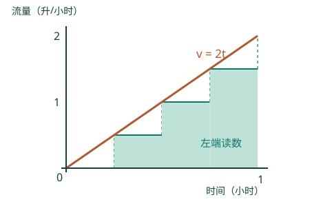

# 水龙头越开越大，怎样把流量表换成水量

一小时内的流量按 $v(t)=2t$ 升/小时增长，$0\le t\le1$。用起始流量乘整段时间会报零，用末端流量又会报两升。两笔估计都把随时间变化的量当成了常量。在每个较短时间段内，开头与末尾的流量较接近，两笔估计之间的空隙或许会逐渐关上。

把一小时等分成 $n$ 段。第 $i$ 段的起始流量是 $2(i-1)/n$，结束流量是 $2i/n$。低估量和高估量分别为
$$L_n=\frac{2}{n^2}\sum_{i=1}^n(i-1)=1-\frac1n,\qquad U_n=\frac{2}{n^2}\sum_{i=1}^n i=1+\frac1n.$$
在各段任选一个采样时刻，算出的水量也夹在其中。不同长度的分割会破坏结论吗？一段长度 $\Delta t$ 上两笔估计相差 $2(\Delta t)^2$；若最长段长为 $m$，所有差加起来不超过 $2m\sum\Delta t=2m$。而每段首尾估计的平均恰是两端平方之差，全部相加为 $1$。精度因此对任何足够细的分割都有效。

一般把区间分开，在第 $i$ 段内取点 $\xi_i$，相加 $\sum_i f(\xi_i)\Delta t_i$，叫**黎曼和**。对有界函数，当最大段长趋向零，各种分法和取点都给同一极限时，就记为 $\int_a^b f(t)\,dt$。**积分的意义在于采样细节对最终累积量的影响能被控制到任意小。** 若积的是有向速度，负值产生负贡献，总和给出位移；想记行程就要积速度的绝对值。
