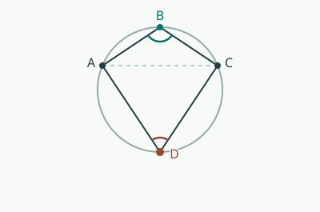

# 四点共圆：第四个点该放在哪里？

在纸上点出三个不共线的点 A、B、C。要用圆规画一个同时经过它们的圆，该把针尖扎在哪里？圆心到 A、B 一样远，所以它在 AB 的中垂线上；同理，它也在 BC 的中垂线上。两条中垂线相交，圆心就确定了。现在添上第四个点 D，圆规已经没有调整的余地。能从图上看出 D 是否也在这个圆上吗？

假设 A、B、C、D 依次是凸四边形的四个顶点。连起对角线 AC。站在 B 点望向 A 和 C，两条视线夹成 ∠ABC；站在 D 点，也能量出一个角 ∠ADC。我们先保留 B 的位置，让 D 在 AC 的另一侧移动。D 所在的位置决定它看到的角。反过来，角的大小能不能限制 D 的位置？

先把 D 放在过 A、B、C 的圆上。B 看着弦 AC 时，∠ABC 所对的是圆上从 A 到 C、不经过 B 的那段弧。D 看的是另一段。两段弧恰好拼成一整圈。圆周角等于它所对弧的度数的一半，所以

$$
\angle ABC+\angle ADC=\tfrac12\cdot 360^\circ=180^\circ.
$$

这给了我们一个检验办法。但如果某个 D 恰好让这两个角加起来等于 180°，有没有可能它仍然落在圆外？为回答这个方向的问题，再画一次过 A、B、C 的圆。在直线 AC 的另一侧，圆弧上的每一点看 AC，看到的都是 180°−∠ABC。这里用到**定角轨迹**：在一条线段的指定一侧，以给定角度看这条线段的所有点，恰好组成一段不含端点的圆弧。于是，量出这个角的 D 一定在这段弧上。

这样就得到了完整的判据。**对于按边界顺序标成 ABCD 的凸四边形，A、B、C、D 四点共圆，当且仅当一对内对角之和是 180°**。

为什么要交代“在哪一侧”？换一幅图，以 AB 为固定线段，让 C、D 在 AB 的同一侧。若 A、B、C、D 互异且任三点不共线，要检验四点共圆，这次该比较的是 ∠ACB 和 ∠ADB **是否相等**。在同一圆上，C、D 看的是同一段弧；反过来，同侧看出同一角度也就落在同一条定角弧上。

试试把“同侧”去掉。在 AB 两边各作一个等边三角形，顶点分别叫 C 和 D。它们看 AB 时同样都看到 60°，这时两个 60° 却是凸四边形 ACBD 的一对对角，加起来只有 120°。所以四个点并不共圆。**做题遇到两个相等的角时，可以先找它们共同看到的线段，再看两个顶点分别落在哪一侧**。

有一个经常遇到的特例。如果图上有两个直角 ∠ACB 和 ∠ADB，注意它们都看着同一条线段 AB。无论 C、D 在 AB 的哪一侧，圆都很容易找：它的直径就是 AB。几何题里看到两处垂足，可以试着连起它们共同看向的那两个端点。这正是直角能引出共圆的地方。
