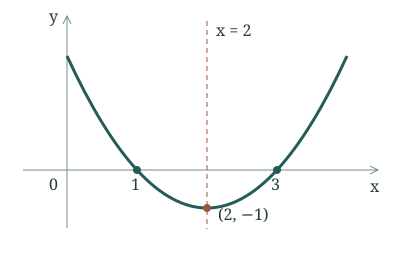

# 二次函数的图像：曲线的两侧为什么会对称？

试给 $y=x^2-4x+3$ 配一张表。输入依次取 $0,1,2,3,4$，高度分别是 $3,0,-1,0,3$。左右好像照了镜子。只凭这五个点，完全可以在两个整数中间另画一条有波纹的线。是什么保证所有实数输入都服从同一种对称？

把式子[配成平方](complete-square.md)，得到
$$
y=(x-2)^2-1.
$$
从二出发向右走 $t$，或向左走 $t$，两点的高度都是 $t^2-1$。**因为 $t$ 可以取任意非负实数，上面的计算把两边整条曲线都配对了。**又因为 $t^2\ge0$，只有 $t=0$ 时高度才降到负一。图上最低的点 $(2,-1)$ 叫**顶点**，把左右两侧互相映过去的直线 $x=2$ 叫**对称轴**。

任何实系数二次函数 $y=ax^2+bx+c$（$a\ne0$）都可写成
$$
y=a(x-h)^2+k,\qquad h=-\frac b{2a},\qquad k=c-\frac{b^2}{4a}.
$$
把输入取成 $h+t$ 和 $h-t$，又得到同一高度 $at^2+k$。若 $a>0$，偏离顶点只会升高，开口向上；若 $a<0$，偏离顶点只会降低，开口向下。在相同横向距离 $t$ 处，竖直变化的大小是 $|a|t^2$，所以 $|a|$ 越大，上升或下降得越快。这类图像都是抛物线。

从图上问“什么时候高度为零”，就等于在解[二次方程](quadratic-roots.md)。图中要让 $(x-2)^2-1=0$，离二恰好一单位，于是横坐标是一或三。若把整条曲线向上平移一单位，它只在 $x=2$ 处碰到横轴；再向上移一点，就没有横轴交点。三个图形把两个根、一个不同实根和没有实根都画出来了。
