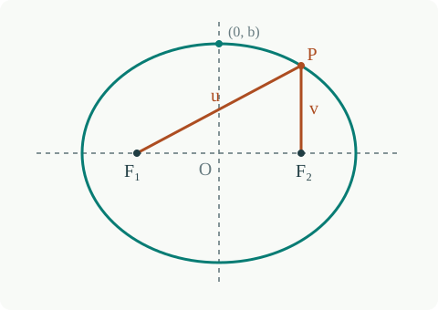

# 两枚图钉和一根绳为什么能画出椭圆？

在纸上钉下 $F_1,F_2$，把一根线的两端分别系在这两点，拿笔尖把线顶紧，沿纸面移动。既然笔尖可以动，它究竟有什么量始终不变？离第一枚图钉远一些，留给第二段线的长度就少一些。笔尖 $P$ 满足的条件只有一个，两段距离的**和**等于绳长。

设两枚图钉的距离为 $2c$，绳长为 $2a$，其中 $a>c>0$。比图钉间距短的绳根本搭不上。长度刚好相等时，笔尖只能待在两钉之间。绳长真正有余量，才能围出曲线。**满足 $PF_1+PF_2=2a$ 的全部点称为椭圆，这两个定点称为焦点**。我们固定这两个点，并没有要求笔尖到每一个焦点的距离各自不变。

要把绳子留下的线写在方格纸上，原点放在哪儿省事？把纸沿两钉的中垂线对折，两枚钉子正好交换位置，两段绳长的和照旧。沿两钉连线对折，两枚钉子又都留在原处。这两条天然的对称线正好可以作坐标轴。取两钉中点作原点、焦点连线作横轴，于是 $F_1=(-c,0), F_2=(c,0)$。

先找笔迹和坐标轴的交点。在右钉外的横轴上，两段距离是 $x+c$ 和 $x-c$，其和为 $2x$，所以笔尖在 $(a,0)$ 把绳子拉紧。在正纵轴上两段绳必定等长，各为 $a$。若把此处的高度记作 $b$，勾股定理就给出 $b^2=a^2-c^2$。难的是中间任意一点，两个根号若一起平方，会冒出根号的乘积。有没有现成的量能把它们拆开？

将 $PF_1,PF_2$ 分别记作 $u,v$。从坐标算距离平方，再作差，恰好消掉两个 $y^2$，得到
$$
u^2-v^2=(x+c)^2-(x-c)^2=4cx.
$$
而 $u^2-v^2=(u+v)(u-v)$，我们恰好知道其中一个因子 $u+v=2a$。所以 $u-v=2cx/a$，从而 $v=a-cx/a$。用 $v^2=(x-c)^2+y^2$，展开两边、约去 $-2cx$，得到
$$
\left(1-\frac{c^2}{a^2}\right)x^2+y^2=a^2-c^2.
$$
记住 $b^2=a^2-c^2$，再除以 $b^2$，就是
$$
\frac{x^2}{a^2}+\frac{y^2}{b^2}=1.
$$

这时可以看出刚才那几个交点为什么是尽头。等式左边两项都非负，所以 $|x|\le a$、$|y|\le b$，而坐标轴上的点恰好能达到这些界限。

**平方有没有偷偷添进绳子画不到的点？** 由 $|x|\le a$ 可知，$a+cx/a$ 和 $a-cx/a$ 都至少是 $a-c>0$。沿计算反推，两个数的平方正是 $PF_1^2,PF_2^2$。因它们都为正，可以取回真正的距离。两者的和也确实为 $2a$。

取图钉间距 $6$、绳长 $10$，则 $c=3,a=5,b=4$。笔尖到达 $(0,4)$ 时，每段线是 $5$。到达 $(5,0)$ 时，两段改为 $8$ 和 $2$。两处离中心的距离已经不同，同一根绳却都能顶紧。若把图钉越移越近而保持绳长，$b$ 会逐渐接近 $a$。两钉重合时，条件变成两倍的半径等于绳长，此时画出的就是圆。
