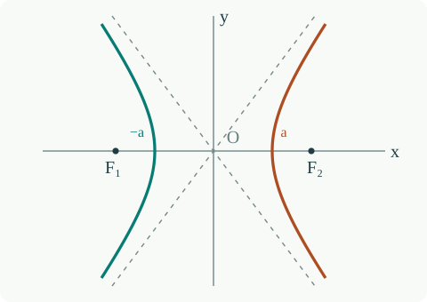

# 为什么两个信号的时间差会画出双曲线？

两个站点 $F_1,F_2$ 同时发出信号，传播速度同为 $v$，沿直线匀速传播。一个接收器报告“第二个信号早到了 $\Delta t$”。如果知道发射时刻和一个信号走过的总时间，就可以求一个距离、画一个圆。眼下只知道两个到达时刻的差，该画什么？

设接收器的位置是 $P$。时间相减再乘速度，得到 $PF_1-PF_2=v\Delta t$。站点间距若为 $2c$，这个差的绝对值至多是 $2c$，因为从 $P$ 经一个站点绕到另一个站点，总路程至少是直达距离。若我们只记早到多少、忘了哪一个先到，就得到
$$
|PF_1-PF_2|=2a,\qquad 0<a<c .
$$
这组点叫作**双曲线**。等号里的绝对值会让两侧各出现一支。如果知道先后顺序，就只保留相应的一支。差为零时，位置落在两站点的中垂线上。差的绝对值刚好等于站点间距时，经近站抵达远站的路线必须和直达路线一样短，位置只能落在两站连线向两头延伸的两条射线上（包括两个站点）。只有严格夹在两者之间的差才给出下面的曲线。

以中点作原点，让两站点落在 $(-c,0),(c,0)$。只看离右站更近的那一支。记 $u=PF_1,v_2=PF_2$，则 $u-v_2=2a$。与[椭圆](analytic-ellipse.md)中的计算一样，平方差从坐标上可以直接得到 $u^2-v_2^2=4cx$。这次我们已经知道差，便能除出和 $u+v_2=2cx/a$，从而 $v_2=cx/a-a$。再写下
$$
(x-c)^2+y^2=(cx/a-a)^2 .
$$
消去两边相同的 $-2cx$，整理为 $(c^2/a^2-1)x^2-y^2=c^2-a^2$。记 $b^2=c^2-a^2>0$，就有
$$
\frac{x^2}{a^2}-\frac{y^2}{b^2}=1.
$$
此式要求 $|x|\ge a$。在 $x\ge a$ 一侧，$cx/a-a\ge c-a>0$，它与 $cx/a+a$ 因而确实分别是两段距离，而差为 $2a$。左边由镜面对称得到相反的先后顺序。这样也查明平方没有引入别的位置。

例如站点坐标 $(-5,0),(5,0)$，路程差的绝对值为 $6$，就有 $a=3,b=4$。点 $(3,0)$ 离两站点分别是 $8$ 和 $2$。另外点 $(5,\tfrac{16}{3})$ 到右站点的距离是 $16/3$，到左站点的距离是 $34/3$，两者仍差 $6$。所以一个时间差不能确定唯一位置。

双曲线能一直向外延伸。以右上方为例，$y=(b/a)\sqrt{x^2-a^2}$。当 $x$ 很大，它与直线 $y=(b/a)x$ 的纵向差为
$$
\frac{b}{a}\left(x-\sqrt{x^2-a^2}\right)
=\frac{ab}{x+\sqrt{x^2-a^2}},
$$
会越来越接近零。这样得到的线叫作**渐近线**，另外的方向由对称性得到 $y=-(b/a)x$。渐近线给出远处图形的走向，真正位于线上的点代入方程左边会得到 $0$，不在曲线上。
