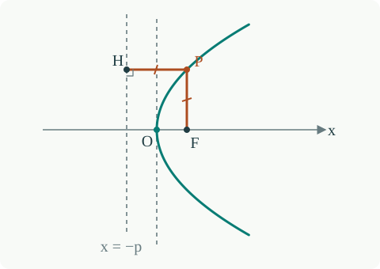

# 离一座塔和一条路同样远，为什么会走出抛物线？

在平面图上把一座塔画成点 $F$，把一条直路画成不经过 $F$ 的直线 $\ell$。有人说“我到塔和到路一样近”。到点的距离好量，到路却可以挑路上的许多落脚点。取哪一个？若只问赶到路边最少要走多远，就从站立处向 $\ell$ 作垂线，量到垂足的那段。走向任何其他落脚点都会成为较长的斜边。我们沿用这一直线距离的定义。

**离 $F$ 与 $\ell$ 的距离相等的全部位置，组成抛物线**。$F$ 叫焦点，$\ell$ 叫准线。在从 $F$ 垂直到 $\ell$ 的短路上，其中点 $O$ 肯定满足条件。沿这条垂线作横轴，以 $O$ 为原点，让 $F$ 在正方向上，焦点坐标写成 $(p,0)$，准线方程就是 $x=-p$，其中 $p>0$。

对一般位置 $P=(x,y)$，去准线只须横走，所以这段距离是 $|x+p|$。去焦点则要走直线段，长度是 $\sqrt{(x-p)^2+y^2}$。**两边都是非负的长度，取平方后仍可从右式推回左式**，得到
$$
(x-p)^2+y^2=(x+p)^2
\quad\Longleftrightarrow\quad
y^2=4px .
$$
右式立刻说明 $x\ge0$，曲线只向焦点所在的半平面张开。每个正的 $x$ 都给两种相反的 $y$，上下两点互为镜像，$O$ 是两支在对称轴上会合的顶点。若课本写 $y^2=2mx$，先找它把哪一段距离叫 $m$。我们这里 $p=OF$，整个焦点到准线的距离是 $2p$，符号差异并不会改变曲线。

取 $p=1$。横坐标为 $1$ 时，方程给 $y=2$ 或 $-2$。若取 $P=(1,2)$，到焦点 $(1,0)$ 的距离是 $2$，到直线 $x=-1$ 也是 $2$。再取 $P=(4,4)$，距焦点为 $\sqrt{3^2+4^2}=5$，直走到准线也恰好是 $5$。

也许你熟悉的是开口朝上的 $y=x^2$。把刚才的轴互换，等距条件就变成 $x^2=4py$。令 $p=1/4$，便得到了它。原来这张二次函数图的焦点是 $(0,\tfrac14)$ ，准线是 $y=-\tfrac14$。以后若只把图左右或上下平移，这两个对象也跟着作同一次平移，等距的理由仍然成立。
