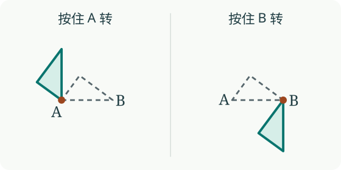

# 怎样检验两张图全等？

剪下一个三角纸片，描一次边，把纸片滑到桌角，转个方向，再描一次。第二个三角形的顶点占着完全不同的位置。如果我们要裁一块替换纸片，两次画出的轮廓都应该能用。这里想保留的是什么？

想让两幅轮廓叠到一起，先把一幅画在透明纸上。捏住纸把顶点 $A$ 滑到另一幅图的对应顶点，纸别转。其余顶点会沿同一方向移动同样远，这样整张纸才保持原样。这种移动叫**平移**。

现在两幅图有一对顶点重合了，边的朝向却可能还没对上。假设你请同桌把纸片“逆时针转九十度”。你按住 $A$ 转，他按住 $B$ 转。看下面两幅图，虚线都是原来的纸片。你们都照做了，哪一个顶点留在了原地？

要让同桌重现你的结果，还得告诉他按住哪个点。**选好中心，让纸上每个点都绕它转过同一个有方向的角，并保持到中心的距离，整张图就有了确定的落点。** 这个动作叫**旋转**。回到叠图的问题，按住刚刚重合的顶点，转到一对对应边朝向相同就可以了。

如果第三个顶点仍落在这条边的另一侧呢？试沿着这条边把透明纸翻过来。折痕是一条直线。折痕上的点留在原处，两侧互换，这就是以这条直线为轴的**轴对称**。这三种动作都保持任意两点的距离和普通角的大小。翻面还会改变三个顶点顺时针或逆时针排列的次序。

**如果经过这些移动能使两个图形完全重叠，我们说它们全等**。要说 $\triangle ABC$ 与 $\triangle DEF$ 全等，字母次序在告诉我们 $A,B,C$ 分别去对准 $D,E,F$。于是 $AB=DE$、$\angle B=\angle E$ 等就是从重合读出来的结论。只写“两图的边一样长”，可能还没有交代是哪条边对哪条边。

能否少比较几个量？假设两图各有一条长 $5$ 的边和一条长 $3$ 的边。把这两条边做成带活页的木条，两端共用一个铰点。只要铰点还能转，另外两个端点的距离就还会变。**可见已有的两个长度不足以锁住整个三角形**。如果再固定**它们的夹角**，就能先使长 $5$ 的边重合，再选定长 $3$ 的边从铰点伸出的方向。必要时翻面，第三个顶点便只能落在同一点。这就是从移动图形读懂“边角边”判定的一种方式。

如果手中只有三条对应边的长度呢？对齐一条底边，让它的两端在方格纸上的位置分别是 $(0,0)$、$(d,0)$，其中 $d>0$。第三个顶点 $(x,y)$ 距两端分别为 $r,s$。按[直角坐标里的距离算法](coords.md)，两段距离的平方相减，两个相同的 $y^2$ 就抵消了：

$$
r^2-s^2=x^2-(x-d)^2=2dx-d^2.
$$

于是 $x$ 已经唯一确定，而 $y^2=r^2-x^2$ 又把高度的绝对值固定了。两个确已做成的三角形，第三个顶点只能在同一处，或隔着底边正好互为镜像。必要时翻面就能重合。这就是“三边”判定。

把重合的想法用在一个可检验的问题上。把纸沿一条直线折起，让点 $P$ 与另一个点 $Q$ 重合。折痕上的点 $M$ 都留在原处。由于折叠保距，从 $M$ 到 $P$ 的线段被送到了从 $M$ 到 $Q$ 的线段，于是 $MP=MQ$。我们得到的是关于折痕上**每一点**的断言，根本不需要拿尺逐个量。关于怎样用这样的重合构造证明，可以接着读[怎样选辅助线](plane-proof.md)。

让同伴凭一句指令辨认图形移动的活动，参考了 [Illustrative Mathematics 八年级第一单元第一课](https://im.kendallhunt.com/MS/students/3/1/1/index.html)。
