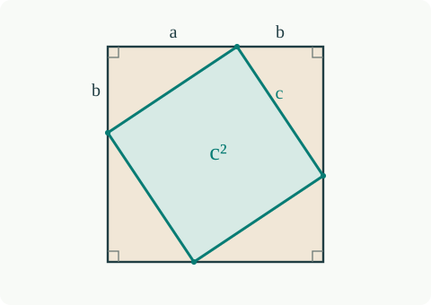

# 怎样用坐标把一个位置告诉别人？

“在我右手边三步的地方。”听的人若换了方向，或一步比你长，就会去错地方。要让一个位置可以写在纸条上传给谁都能找到，双方必须先约定什么？

在一张平面图上钉一个原点 $O$，从它画两条互相垂直的数轴。我们叫一条横轴 $x$，另一条纵轴 $y$，指定各自的正方向，并在两轴上约定同样长的一格为 $1$。这就是平面直角坐标系。把纸上的点 $P$ 垂直投到两根轴上，读出有正负号的刻度，按先横后纵的约定写成 $(x,y)$。反过来，过横轴刻度 $x$ 作纵向直线，过纵轴刻度 $y$ 作横向直线，交点恰好有一个。**正是“一个数对能找回唯一一点”，让这套记录能来回使用**。

比如 $P=(3,-2)$，表示从原点沿横轴正向走 $3$ 个单位，再沿纵轴负向走 $2$ 个单位。$(-2,3)$ 会落到另一处。若把原点搬到旧坐标 $(1,1)$ 而保持轴方向和刻度，去同一个 $P$ 只需向右 $2$、向下 $3$，它的新坐标就是 $(2,-3)$。点一直在那里，读数会随坐标系改变。

位置记下来，能不能算两点之间的直线距离？从 $A=(-1,1)$ 去 $B=(2,5)$，沿网格横走 $3$、竖走 $4$，这条折线路长 $7$。拉直的线段是一只直角三角形的斜边。它的长度为什么可以只靠两段横竖位移算出来？

取四张同样的直角三角纸片，两条直角边分别长 $a,b$，斜边长 $c$。在边长 $a+b$ 的正方形四角各放一张，让直角落在角上，四张依次转四分之一圈。沿每条外边，前一张用掉 $a$、后一张用掉 $b$，恰好接上。中间留下的四条边都是斜边，每个内角都是直角，因为相邻纸片挨在一起的两个锐角恰好拼成一个直角。中间这个正方形的面积既是 $c^2$，也是大正方形扣去四张纸片，即 $(a+b)^2-4ab/2=a^2+b^2$。这就是**勾股定理**。需要回看面积怎么算，可以读[怎样量面积](measure.md)。

回到那两个点，直线距离是 $\sqrt{3^2+4^2}=5$。一般地，两点分别为 $(x_1,y_1),(x_2,y_2)$ 时，
$$
AB=\sqrt{(x_2-x_1)^2+(y_2-y_1)^2}.
$$
向左或向下的坐标差会带负号，但平方后仍是相应直角边长度的平方。**这个推理用了轴互相垂直、单位相同两个约定**。把横轴的一格画成纵轴的两倍长，照抄公式便会把距离算错。

有了这套约定，一串数可以恢复一张图。更值得一问的是，能不能只给一条约束就恢复一整条线？试着把“到一个固定点总是一样远”翻译成坐标，就会走到[曲线与方程](curves.md)。
