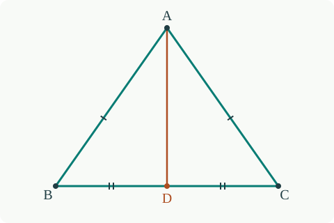

# 写几何证明时，怎样想到要画哪条辅助线？

在纸上画一个三角形 $ABC$，两边 $AB,AC$ 同样长。你量了几幅图，发现底边两端的角 $\angle ABC$ 和 $\angle ACB$ 看上去总是一样大。这让人愿意猜下去，但即使量到小数点后十位，也还没有说明任意一个这样的三角形都会如此。我们得用上题目给的“等长”。

一种试法是沿着感觉从 $A$ 随便连到底边某一点 $D$。就出现了两块小三角形，它们有等长边 $AB,AC$，也有共同边 $AD$。但两条对应边等长还不够锁定三角形，因为夹角可以像铰链一样变化。现在缺哪一件东西？如果 $D$ 恰是 $BC$ 的中点，还会得到 $BD=DC$，两块三角形的**第三对边**就齐了。**正是这条缺口，让“取中点”成了有理由的一步**。

线段有中点，所以这样选 $D$ 总能做到。三边对应相等，说明 $\triangle ABD$ 与 $\triangle ACD$ [全等](congruent.md)。重合时 $B$ 对应 $C$，$D$ 保持不动，因此 $\angle ABD=\angle ACD$。由于 $D$ 在线段 $BC$ 内，这两个角正好就是原来要比较的底角。顺着同一对应关系还能读出 $\angle BAD=\angle DAC$，而 $\angle ADB=\angle ADC$ 且两角拼成平角，各为 $90^\circ$。原来我们挑的是中线，走到最后才发现它在这个三角形里又是角平分线和高。

还有一条完全可行的路。若一开始就从 $A$ 平分顶角，令分角线交 $BC$ 于 $D$，两块三角形便有 $AB=AC$、$AD$ 公共，外加这两边之间的角相等，于是可用边角边判全等。两条路用的是不同线索。**若只在图上挑一个“看起来很居中”的点，却把等边、分角、垂直一口气全当已知，论证就悄悄提前借用了结论**。

下次碰到一道几何题，可以先问目标是比较哪两个量，再看看有什么已知相等能把它们放进同一对对象里。另一些题中，两个角出现在相距很远的地方，硬凑三角形可能一直差一对边。若这两个角都看着同一条线段，则有另一条路，可用[四点共圆](../concyclic.md)把角从一个顶点移到另一个顶点。知道哪条等式还缺一个理由，就知道往图上添什么了。
