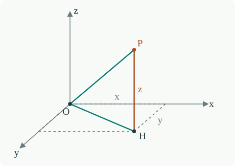

# 为什么空间里确定一个点要用三个坐标？

一间屋子的平面图给出了吊灯的位置。电工在图上标出的位置站定，向上望去。吊灯紧贴天花板也好，垂下来半米也好，在地板上的垂直投影都落在他的脚下。平面图缺的恰是**沿竖直方向离开地板多少**。

选房间一角作 $O$，从这里沿两条相互垂直的墙脚设置 $x,y$ 轴，再沿竖直墙棱设置 $z$ 轴。三轴两两垂直，并使用同一长度单位。墙边朝向房间内及向上取正。要用它们描述室外或地板以下的点，也可把各轴向相反方向延伸，使用负坐标。给定一个空间点 $P$，先向 $xy$ 平面作垂线并取垂足 $H$，用平面坐标 $(x,y)$ 描述 $H$，再用带符号的高度 $z$ 记录从 $H$ 到 $P$ 的距离。**反过来，照这三项指令即可找到唯一位置**。

例如 $(3,4,2)$ 表示先在地面上向 $x$ 正向走 $3$、向 $y$ 正向走 $4$，再向上走 $2$。在这个例子里，从墙角到地面影子的斜线长 $\sqrt{3^2+4^2}=5$。它躺在水平面内，所以与最后竖直的那一段垂直。再用一次勾股定理，从墙角直达该点的距离为 $\sqrt{5^2+2^2}=\sqrt{29}$。用两次平面勾股就量到了空间斜线。

从任意 $A=(x_1,y_1,z_1)$ 去 $B=(x_2,y_2,z_2)$，只须把刚才的三段换成坐标差。位移的[向量](vectors.md)就有了分量表示
$$
\overrightarrow{AB}=(x_2-x_1,\ y_2-y_1,\ z_2-z_1).
$$
若把这三项记为 $\Delta x,\Delta y,\Delta z$，直达距离为 $\sqrt{(\Delta x)^2+(\Delta y)^2+(\Delta z)^2}$。有了分量，沿向量走 $t$ 倍，就是把三个分量都乘 $t$。例如从 $A=(1,0,2)$ 到 $B=(5,2,0)$ 的中点，是从 $A$ 出发加上 $(4,2,-2)$ 的一半，落在 $(3,1,1)$。

还可以只记录什么变化被允许。从固定点 $P_0$ 沿非零向量 $\mathbf u$ 走任意实数倍，$P=P_0+t\mathbf u$ 走出整条直线。再允许沿第二个非平行向量 $\mathbf v$ 移动，$P=P_0+s\mathbf u+t\mathbf v$ 会铺满一个平面。要验证这一点，在面内分别过目标点作与两方向平行的线，就能反找出所需的两段位移。**若两向量平行，第二个方向只会带你在同一条线上来回**，这也是判定平面时要坚持选[两条不同方向](solid-parallel.md)的原因。
