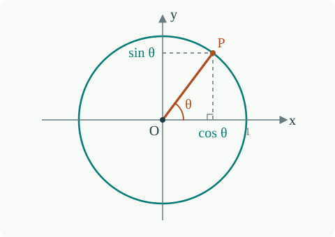

# 同样陡的坡为什么共用一组三角函数值？

一条坡道沿水平方向走 $4$ 米，上升 $3$ 米。把坡道继续向前铺，若始终同样陡，上升高度会变，斜坡长度也会变。有没有一个量可以写在施工图上，专门表示“同样陡”？

截出任意两段这样的直坡，各补成一个直角三角形。两图有一个直角和同样的倾斜角 $\theta$，于是[相似](similar.md)。**对应边都按同一倍数变化，两边的比就保持不变了**。对锐角 $\theta$，斜边对着直角，其余两边分别是挨着 $\theta$ 的邻边、与 $\theta$ 相对的对边。我们把对边除以斜边叫 $\sin\theta$（正弦），邻边除以斜边叫 $\cos\theta$（余弦），对边除以邻边叫 $\tan\theta$（正切）。刚才斜边长 $5$ 米，三个比分别为 $3/5,4/5,3/4$。换一条同样倾斜但长 $20$ 米的斜坡，便可预测高度为 $20\times3/5=12$ 米。

如果把坡板继续绕固定端转，越过竖直位置，“邻边的长度”永远为正，却应当开始往左走了。怎样把同一个想法延伸下去？

在直角坐标系里，从原点向右放一根长为 $1$ 的箭头，让它转过 $\theta$。约定逆时针为正，顺时针为负，端点 $P$ 始终在半径为 $1$ 的圆上。对锐角，向横轴作垂线以后，三角形的斜边是 $1$，水平位移正好是原来的余弦，竖直位移是正弦。因此对一般的有向角，也约定
$$
P=(\cos\theta,\ \sin\theta).
$$
现在转到 $150^\circ$，水平位移朝左，竖直位移向上，它是 $30^\circ$ 时端点关于纵轴的镜像。转到 $180^\circ$，端点就在 $(-1,0)$。这时候用坐标读数比重新给每个象限背一套符号更稳妥。

图还给出两个可以自己检查的结论。**箭头转满一圈，端点回到原来的位置，所以正弦和余弦在角度增加 $360^\circ$ 后重复**。端点到原点距离一定是 $1$，所以任何角都满足 $\cos^2\theta+\sin^2\theta=1$。若用弧长量角，规定半径为 $r$ 的圆上长为 $s$ 的弧所对角的大小为 $s/r$ 弧度。把圆周长与直径的比记作 $\pi$，整圈的弧长就是 $2\pi r$，所以整圈等于 $2\pi$ 弧度。最后，坡的竖直位移除以水平位移给出 $\tan\theta=\sin\theta/\cos\theta$，只在分母非零时有意义。坡板竖直时，刚才那个用水平距离来比较陡度的办法恰好失效了。
