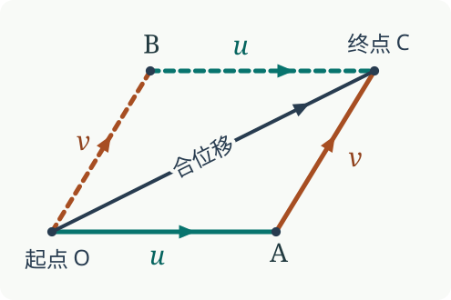

# 搬动一支箭头，它还是同一个位移向量吗？

一张描图纸盖在原图上。抓住纸的一角，向右挪两格、向上挪一格，保持纸不转动。每个点的起点都不同，收到的移动指令却相同。我们想把这条对整张纸都适用的指令记下来。

画一支从旧位置 $A$ 指向新位置 $B$ 的箭头，叫它 $\overrightarrow{AB}$。**若另一个点从 $C$ 到 $D$ 的方向和距离都一样，两支箭头平移过去能完全重合，它们就表示同一个位移向量**。

单说“点 $A$”，知道的是一个位置，还不知道纸要往哪里移动。若纸留在原地，位移为零，这时也无需指定方向。

先做移动指令 $\mathbf u$，再做 $\mathbf v$，能不能用一支箭头代替全过程？在下图的起点 $O$ 用手指沿实线走，先向右到 $A$，再斜向上到 $C$。第一步把你送到哪里，第二支箭头就从哪里出发。

**要把这两次移动合成一道指令，只须画出从最初位置 $O$ 直接指向最终位置 $C$ 的箭头**。我们把它叫作 $\mathbf u+\mathbf v$。

现在回到 $O$，调换次序，改走虚线。第一步沿 $\mathbf v$ 到 $B$，第二步沿 $\mathbf u$ 向右。为什么刚好也到 $C$？把底边那支 $\mathbf u$ 沿 $\mathbf v$ 平移，它的起点从 $O$ 到了 $B$，终点也从 $A$ 到了 $C$。平移出来的两组对边构成一个平行四边形，共用的对角线说明

$$
\mathbf u+\mathbf v=\mathbf v+\mathbf u.
$$

如果第一次向东走 $3$ 米，第二次向北走 $4$ 米，人一共走了 $7$ 米。从起点直指终点的箭头却只有 $5$ 米，可以用[勾股定理](coords.md)算出来。若先向南走 $4$ 米、再向西走 $3$ 米，正好退回起点，这两步合成的就是原位移的**相反向量**。把去程与回程的位移相加，结果是零。

重复走同样一段两次得到 $2\mathbf u$。要是只走一半，方向不变，得到 $\tfrac12\mathbf u$。一般的数乘 $k\mathbf u$ 把长度乘以 $|k|$，$k$ 为负时再把方向反过来。

描图纸和箭头已经说清了一次移动。若想用数把它记下来，可以另选两条坐标轴。从 $(1,5)$ 到 $(4,2)$，横向增加 $3$、纵向减少 $3$，于是位移记为 $(3,-3)$。从 $(-2,1)$ 走到 $(1,-2)$，同样是这个向量。

接连做两次移动时，横、纵两个方向都各自累计变化，这就是分量相加。旋转坐标轴会改写分量，街上走过的那段位移依然一样。再追问“两支基本箭头的去向能否决定整张图的变化”，就会进入[矩阵乘法样章](../matrix-multiplication.md)。
