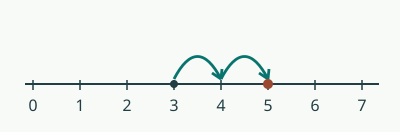

# 怎样把两堆石子合到一起？

左盘三颗，右盘两颗，倒在一起可以从头数。可既然左盘已经数过，重头来一遍很浪费。把右盘的一颗挪过来，左盘的数量走到下一个数；再挪一颗，再走一步。直到右盘为空，这个操作就完成了。

用 $S$ 表示[自然数的后继](natural.md)。若第二堆为空，第一堆的数量没变；若第二堆比 $b$ 多一颗，可以先合进 $b$ 颗，最后再走一步。这给出了对一切自然数都适用的递归定义：
$$
a+0=a,\qquad a+S(b)=S(a+b).
$$
以 $3+2$ 为例，右盘的两颗石子分两次挪：

$$
3+2=S(3+1)=S(S(3+0))=5.
$$

**定义右边每次都只问一个更小的第二堆，最终能回到已经有答案的 $a+0$**。

## 先合哪两堆，有差别吗？

面对 $a,b,c$ 三堆石子，可以先合前两堆，也可以先合后两堆。要证明 $(a+b)+c=a+(b+c)$，固定 $a,b$，让 $c$ 从 0 往上走。$c=0$ 时两边都是 $a+b$。若在 $c$ 时相等，把 $c$ 换成 $S(c)$，左边成为 $S((a+b)+c)$，右边成为 $a+S(b+c)=S(a+(b+c))$。原来一样的两个数各取一次后继，仍然一样。这就由归纳给出了加法结合律。

把左右两盘调换，数的还是那些石子。这个动作很简单，写下的定义却只许我们从**右盘**取下一颗。要用它证明 $a+b=b+a$，先试起点 $a+0=0+a$。左边已经是 $a$，右边怎样算？沿右盘的数量走就行。$0+0=0$，而每当 $0+b=b$ 时，$0+S(b)=S(0+b)=S(b)$。于是 $0+a=a$ 也有了依据。

再试下一步。若已经知道 $a+b=b+a$，加在右盘的最后一颗能把 $a+S(b)$ 变成 $S(b+a)$。可我们想走到的地方是 $S(b)+a$。眼下还少一个理由。**开头多给一颗，和走完以后补一颗，结果相同吗？** 固定 $b$，从 $a=0$ 开始，$S(b)+0=S(b+0)$。每让 $a$ 增加一步，$S(b)+a$ 和 $S(b+a)$ 都随之取一次后继，所以它们一直相等。接上这一步便得到
$$
a+S(b)=S(a+b)=S(b+a)=S(b)+a.
$$
起点和向前一步都已走通，这就证明了加法交换律。

合并也能反过来问。“从 $a$ 还要添多少才到 $b$？”若有自然数 $c$ 使 $a+c=b$，我们就记 $a\le b$；还差的这个数记作 $b-a$。它会有两个答案吗？若 $c$ 比另一个答案多走了一步或几步，$a+c$ 也会多走同样多步，不可能在同一个位置停下。[零与后继的规则](natural.md)排除了数列绕回原处。若手里只有两颗却要拿走五颗，这个问题在自然数里还没有答案。

这也解释了数石子时的自由：你可以交换两个盘子，可以选不同的顺序合三堆。**只有一处必须留心：同一颗石子如果在两份名单上都出现，直接相加会算它两次**。
