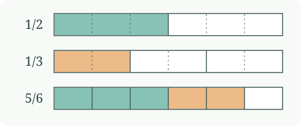

# 半张纸加三分之一张，为什么要换刻度？

用同样大的纸作单位，取一张的一半，再取另一张的三分之一，合起来有多大？一个诱人的算法是把两处的“取一份”和“分了几份”分别相加，得到 $2/5$。先不用知道正确结果也能发现问题。半张再多添一块，应该超过半张；$2/5$ 连半张都不到。把整张分成十份，$2/5$ 只占四份，半张却占五份。

症结出在“一份”这个词上。一份半张和一份三分之一张虽然都写作 1，单位却不同。把每一半均分成三小份，再把每一个三分之一对半切，两边最终都用整张的六分之一作单位。第一块有三小份，第二块有两小份，总数于是为 $5/6$。

一般地，$b,d$ 都取正整数，$\frac ab+\frac cd$ 可以统一到 $bd$ 等份。用[有理数的等价条件](rational.md)得到
$$
\frac ab+\frac cd=\frac{ad}{bd}+\frac{bc}{bd}=\frac{ad+bc}{bd}.
$$
相加的是相同单位的小份。若纸的大小本来不同，得先选共同的长度或面积单位再算。把小纸的一半和大纸的一半相加，不能只凭两个分数就确定占任选一张的多少。

统一到 $bd$ 总可行，却不一定方便。$\frac16+\frac14$ 可以把整张分成 24 格，也可以只分 12 格，得到 $2/12+3/12=5/12$。两种刻度为什么必定一致？把 12 格再各对半，原本五格恰占十格，$5/12=10/24$。当分子有负号时也一样，例如从 $\tfrac16$ 减去 $\tfrac14$，在十二等份的刻度上从第 2 格退 3 格，就会停在 $-1/12$。
