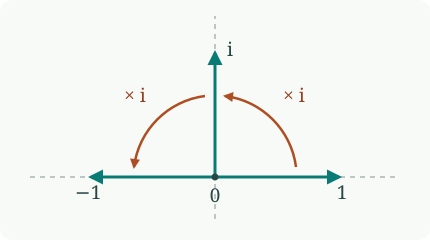

# 数轴上的掉头，能拆成两次同样的转弯吗？

数轴上，每个数乘以 $-1$ 都会走到原点的另一侧，离原点一样远。能不能找一个数，让“乘它两次”刚好完成一次掉头？从 1 出发，这就要求 $i^2=-1$。在实数里试到哪儿都行不通：正数乘正数为正，负数乘负数也为正，0 的平方仍是 0。

把纸面从一条线展开。画一个向右的单位箭头，逆时针转过直角，它会向上；再转一个直角，它便向左。这倒真的把一次掉头平分成了两个相同的动作。于是试着用一对实数 $(a,b)$ 记录“向右 $a$、向上 $b$”的终点。原来数轴上的 $a$ 记作 $(a,0)$，而 $(0,1)$ 暂且叫作 $i$。这些新对象能做算术吗？

先试加法。接上两段位移，水平量和水平量相加，竖直量和竖直量相加。这样 $(a,b)$ 可以写成 $a+bi$，意思是从实轴上的 $a$ 再走 $b$ 个竖直单位。两个这样的数相等，当且仅当水平量、竖直量分别相等。

再试乘法。一个顺手的办法是两项各乘各的，可这样算 $i\cdot i$ 会得到 $(0,1)$，箭头根本没掉头。若想保留整数一路带来的分配律，让实数系数能与 $i$ 交换乘法次序，并让 $i^2=-1$，各项该去哪里其实已经定了：
$$
(a+bi)(c+di)=ac+adi+bci+bd\,i^2=(ac-bd)+(ad+bc)i.
$$
于是就用右边作为两对实数的乘法规则。这不需要先相信有个神秘的数能平方成 $-1$：按规则把 $(0,1)$ 与自己相乘，确实得到 $(-1,0)$。**把 $(a,b)$ 乘以 $i$ 则得到 $(-b,a)$，和图上逆时针转直角吻合**。例如 $2+i$ 转一次到 $-1+2i$，转两次到 $-2-i$。把这幅图当作[平面坐标](../geometry/coords.md)来读，可以看见每一项究竟去了哪里。

还有个关卡：除了零，每个新数还能用来作除数吗？拿 $2+i$ 试试。直接求倒数不太好猜，但若配一个 $2-i$，展开时带 $i$ 的两项正好抵消，乘积是 5。因此 $(2-i)/5$ 就是 $2+i$ 的倒数。一般地
$$
(a+bi)(a-bi)=a^2+b^2.
$$
只要 $a,b$ 不同时为 0，右边就是正实数，可以相除，我们便得到了倒数 $(a-bi)/(a^2+b^2)$。**按上述规则运算的实数对叫作复数**。把所有竖直分量都取 0，再试一次加法和乘法，你会算回原来的实数结果。

最后试着把实数的大小次序也搬上来，并要求正数相乘仍为正。在这种次序里，每个非零数的平方都得大于 0（若它为负，就先取相反数）。可 $i^2=-1$。所以平面里的位置能记下两种方向，却无法给所有复数同时安排一个保留原有加法、乘法性质的从小到大次序。
