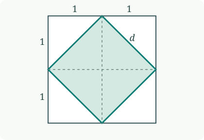

# 那条对角线到底有多长？

在方格纸上取一个边长为 2 的正方形，连起四条边的中点。里面这块斜放的正方形，每条边都是一个单位方格的对角线。外框面积是 4，四个角上各留了半个单位方格，所以里面剩下 $4-4\times\frac12=2$。记对角线长为 $d$，同一块地既可以写成面积 2，也可以写成 $d^2$。我们要找一个正的数，自己乘自己恰好等于 2。

## 会不会只是分母还不够大？

不妨真的试着写 $d=p/q$，其中 $p,q$ 都是正整数。只要分子分母都是偶数，就把它们一起除以 2；正整数分母每次变小，这个过程一定会停。于是可以假定手里这对数至少有一个是奇数。

由 $p^2=2q^2$，$p^2$ 是偶数，因此 $p$ 也是偶数。理由很短：奇数总形如 $2k+1$，平方是 $2(2k^2+2k)+1$，依然是奇数。写 $p=2m$ 代回，得到 $q^2=2m^2$，这回 $q$ 也得是偶数了。刚才已经把公有的因子 2 除尽，现在却又冒出一个。矛盾出在最初的猜测：没有正分数的平方等于 2。不能写成两个整数之比的实数，叫作**无理数**。

## 把试出来的边界钉在恰好的地方

**没有分数解还不能证明有实数解**。回到那块面积为 2 的正方形。试一个边长，只要面积还不到 2，就知道边还可以再放长一点。反过来，试出了过大的面积，再把边放长只会离目标更远。这样一来，即使不知道准确的边长，也可以先收集所有「做出来的面积不超标」的试值，再问它们最远能伸到哪里。

换成任意正实数 $a$ 作目标面积，合格的边长便是所有满足 $x\ge0$ 且 $x^2\le a$ 的实数。0 一定合格，$a+1$ 已经太长，因为 $(a+1)^2>a$，更长的边也不会合格。按[实数的完备性](real.md)，这些边长有一个最小上界，记作 $s$。还不能直接说 $s$ 就是答案。如果 $s^2$ 偏小，试着把边放长一点。如果 $s^2$ 偏大，试着把上界推回去一点。每次究竟可以改多少？

- 若 $s^2<a$，还剩一块面积。把边长增加一点 $h$，面积只多 $2sh+h^2$。选 $0<h<1$ 且 $h<(a-s^2)/(2s+1)$，增加的面积就小于差额。于是 $s+h$ 也在集合里，越过了上界。
- 若 $s^2>a$，此时 $s>0$。从边长削去一条窄边，选 $0<h<s$ 且 $h<(s^2-a)/(2s)$，就有 $(s-h)^2\ge s^2-2sh>a$。所有合格的边长都比 $s-h$ 小，因为在非负数里，边越长，平方越大。这样 $s-h$ 也是上界，又比最小上界还小。

两边都推不开，只能是 $s^2=a$。而且非负边长中只会有一个答案：若 $0\le u<v$，则 $v^2-u^2=(v-u)(v+u)>0$。**我们把这个唯一的非负数记作 $\sqrt a$**；$a=0$ 时它就是 0。单位方格的对角线终于有了一个精确的名字 $\sqrt2$。

这也解释了一处常见的符号误会。面积为 9 的正方形边长是 $\sqrt9=3$。若问题换成“哪个实数的平方为 9”，$-3$ 也合格。满足 $x^2=a$ 的每个实数都叫 $a$ 的**平方根**，其中非负的那个称为**算术平方根**，用根号来记。因而 $\sqrt{x^2}$ 取的是 $x$ 到 0 的距离，也就是它的绝对值 $|x|$。例如 $x=-3$ 时得到 3。若要让一个数的平方等于 $-1$，无论正负实数都做不到。那会把我们带到另一个问题：[能否造出一种新的数来办到这件事？](complex.md)
