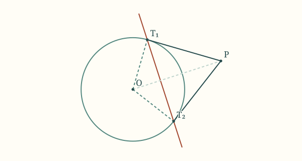

# 连起两个切点，为什么能只用圆外一点写出这条线？

在圆 $x^2+y^2=25$ 外取 $P=(0,10)$，从 $P$ 作两条切线。若先求各自的斜率再求两个切点，过程很长。试把未知切点 $T=(x,y)$ 的两条条件放在一起：$OT$ 垂直于 $PT$，又有 $|OT|^2=25$。用点积写前一条，$T\cdot(P-T)=0$，恰好能借后一条消去二次项。因此 $T\cdot P=25$，即 $y=2.5$。两个切点都在这条水平线上，它就是切点弦所在的直线。

一般地，对圆心在原点、半径为 $r$ 的圆及非圆心点 $P=(u,v)$，称 $ux+vy=r^2$ 为 $P$ 的**极线**，$P$ 则称为该直线的极点。若 $P$ 在圆上，极线就是过它的切线。若 $P$ 在圆内，从它画不出实切线，但一次方程仍然产生一条直线。它的法向量是 $OP$，离圆心的距离为 $r^2/OP$，故与射线 $OP$ 的交点正是 $P$ 的反演像。

**极点、极线的互换来自点积的对称性。** 如果 $Q$ 位于 $P$ 的极线上，那么 $P\cdot Q=r^2$，同时也说明 $P$ 在 $Q$ 的极线上。这就允许我们把“证明许多直线都穿过同一点”改写成“证明这些直线的极点都在一条线上”。
