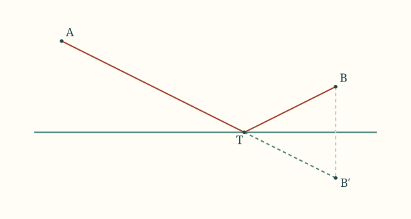

# 必须到河边碰一下，最短的折线路线怎样找？

村庄 $A=(0,2)$、$B=(6,1)$ 同在直河岸 $y=0$ 的北侧。要从 $A$ 经岸边任一点 $T$ 去 $B$，直接连 $AB$ 到不了岸。若逐个试 $T$，一段缩短时另一段往往变长，难以比较总和。

折纸，把 $B$ 关于河岸反射到 $B'=(6,-1)$。对岸上每个 $T$ 都有 $TB=TB'$，所以原来两段长之和等于 $AT+TB'$，至少为 $AB'=\sqrt{45}$。连接 $AB'$ 确实穿过河岸，交点是 $(4,0)$，于是这个下界真的能走出来。**把一个端点移到镜像，要保留的是每条候选路线的长度；把路线拉直才给出最优位置。** 若只准在岸边的一小段取水，还需检查交点是否落在允许范围内，否则在该段上比较，不能直接取上述答案。

换一种约束，两段的接头还要相差一个固定向量，例如中间必须沿固定方向跨一座长为 $d$ 的桥。把终点平移一个反桥向量，就能删掉那段恒长的桥，再对余下的两段用三角不等式。若接头间给的是固定转角和相等边长，试旋转更自然：绕 $O$ 把 $P$ 转 $60^\circ$ 到 $P'$，则 $PP'=OP$，整段原本连向 $O$ 的距离便能被搬到 $PP'$。这正是[费马点](fermat.md)的构造所用的等长关系。
