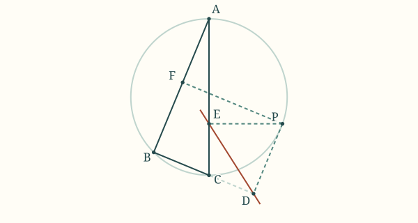

# 三个垂足落在同一直线上，圆在背后做了什么？

从平面一点 $P$ 向三角形的三条边所在直线作垂线。通常三个垂足围成小三角形。让 $P$ 在外接圆上移动，却会看到小三角形压扁。取 $D\in BC,E\in CA,F\in AB$ 为垂足，要证共线，只须让直线 $ED,EF$ 的有向夹角为零。

直接追这两条新线没有着力点，先从 $E$ 连 $P$。因两垂角为直角，$C,D,P,E$ 在以 $CP$ 为直径的圆上，$A,E,P,F$ 在以 $AP$ 为直径的圆上。因此
$$
(ED,EP)=(CD,CP),\qquad (EP,EF)=(AP,AF).
$$
相加，右边变成 $(CB,CP)+(AP,AB)$。这时才用到 $P$ 在 $ABC$ 的外接圆上：$C$ 和 $A$ 同看弦 $BP$，所以 $(CB,CP)=(AB,AP)$，两项恰好抵消。所有等式都按 $180^\circ$ 计，故 $D,E,F$ 共线。这条线叫西姆松线。

**两个小圆把垂足的问题搬回原三角形，第三个圆负责消掉最后那个角。** 这串等价关系倒着读，在点与直线没有重合的情形下，还能由三垂足共线推出 $P$ 在外接圆上。特殊位置可直接验算，例如 $P=A$ 时，两只垂足都落在 $A$，余下一个是 $A$ 到 $BC$ 的垂足，所得直线恰为这条高。
