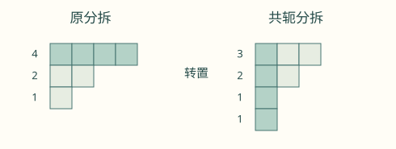

# 把数字拆成几份，为什么能把行列互换？

把 $5$ 写成若干正整数的和，只计各份大小，$3+2$ 与 $2+3$ 是同一个整数分拆。要统一记录，把部件按非增顺序排列，并在每行左对齐画出相应数目的格。譬如 $4+2+1$ 的七格图有三行、四列，从上到下的行长为 $4,2,1$。

沿主对角线反射这张图，原列长 $3,2,1,1$ 变成新行长，所得是七的另一个分拆。图仍左上对齐且行长非增，反射两次则还原，这叫共轭分拆。因此“恰分成三份”的图，恰好配给“最大部件为三”的图，因为行数与最长行互换。**图形让两道看起来不同的限制交换了身份，而且留下可逆的对应。**

若还想系统算数目，记 $p(n,k)$ 为分拆 $n$ 且所有部件不超过 $k$ 的方式数。按是否出现 $k$ 分类，没出现的有 $p(n,k-1)$；出现的删去一份 $k$，恰与 $p(n-k,k)$ 配对。取 $p(0,k)=1$、负数参数 $n$ 的方式为零，就可以从小数向上递推。这里的部件没有个人身份；与把若干名不同学生分组的[集合划分](partitions.md)计数不同。
