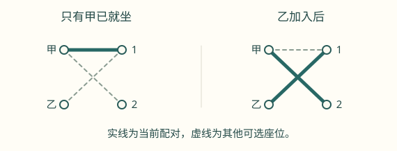

# 一次只能加一对吗？

甲可坐 $1,2$ 号座，乙只能坐 $1$ 号。若先排甲坐 $1$，乙无空座，却不该宣布最多只能安排一人。沿乙—$1$—甲—$2$ 看过去：先经过可用但未选的边，再经过已选的，再经过未选的。翻转这条路上所有边的选用状态，甲换到 $2$，乙占 $1$，总数增加一。

一组无共同端点的边叫匹配。这样从未配点到另一不同未配点、首尾均未选且中间交替的简单路叫增广路。翻转以后，中间每点仍占一条匹配边，两端新得到伙伴，所以每条增广路都会使匹配多一条。仅仅不能再直接添边，说明极大，尚未说明边数最大。

反过来，若有更大的匹配 $M'$，在它和当前 $M$ 中擦掉共同边。剩下每个点至多接两条边，若有两条则各来自一方，故分量为交替的路径或偶圈。圈的两种边一样多，而 $M'$ 总边数较多，必有一条路径两端都是 $M'$ 的边，且两端在 $M$ 中无配边。这正是增广路。**找不到增广路才给出最大性的证书。** 所有顶点都已配到的匹配称完美匹配。
