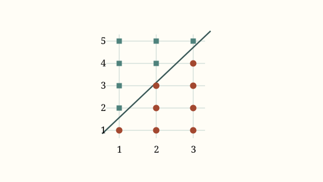

# 判断 13 在模 17 下是不是平方，能交换这两个素数吗？

列出每个平方当然会给答案，但模数很大时，这张表太长。若能把分子分母倒过来，就能继续用余数把数字变小。实验会发现交换有时保持符号、有时改变符号。要看清这个符号，从半张乘法表入手。

设 $p,q$ 为不同奇素数，$h=(p-1)/2$。将 $q,2q,\ldots,hq$ 各自取模 $p$，写成 $\pm1,\ldots,\pm h$ 中绝对值最小的代表。这些绝对值全异：两个相同会给 $i\equiv\pm j\pmod p$，在 $1,\ldots,h$ 中只能 $i=j$。记负号数为 $N$，乘整张表并消去 $h!$ 得 $q^h\equiv(-1)^N$，从[欧拉判别法](quadratic-residue.md)知这就是 $(\frac qp)$。这是高斯引理。

怎样让 $q,p$ 能够对调？设 $iq=p k_i+r_i,\ 0<r_i<p$。把 $r_i>h$ 的数换作 $p-r_i$ 后，正好得到 $1,\ldots,h$ 的重排。每换一次，奇偶性翻转一次；$p,q$ 都为奇数，故将上式对 $i$ 求和并模 $2$，有 $\sum k_i\equiv N\pmod2$。而 $\sum k_i=\sum_{i=1}^h\lfloor iq/p\rfloor$，恰是整数矩形 $1\le i\le h,\ 1\le j\le (q-1)/2$ 内直线 $j=iq/p$ 下方的点数。倒换 $p,q$ 数到的恰是线上方，线上没有整数点。因此
$$
\left(\frac qp\right)\left(\frac pq\right)=(-1)^{(p-1)(q-1)/4}.
$$

图中下方圆点数按列相加是 $1+3+4=8$，其余 $7$ 个方点在上方。一边取偶、一边取奇，乘积便为负，恰因 $7,11$ 都模 $4$ 余 $3$。

**交换两个素数就是从矩形的一边换到另一边去数。** 只有两素数都模 $4$ 余 $3$ 才出现负号。本例 $(\frac{13}{17})=(\frac{17}{13})=(\frac4{13})=1$；验证 $8^2\equiv13\pmod{17}$。这个互反公式针对两个不同奇素数，分子若为 $2$ 则要另用高斯引理数 $2,4,\ldots,p-1$ 中超过 $p/2$ 的项。

关于一条对角线把格点数分成两半的另一种书写，可以对照[Ben Lynn 的二次互反律讲义](https://crypto.stanford.edu/pbc/notes/numbertheory/quadrecip.html)。
