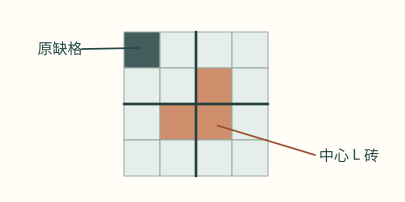

# 一块缺了地砖的棋盘，为何会变成四个同样的问题？

一块 $2^n$ 乘 $2^n$ 的方格棋盘任意缺一格，要用每块覆盖 $2$ 乘 $2$ 去掉一角的 L 形砖铺满。先数面积，$4^n-1$ 可被三整除，但总数合适没有给出砖的位置。把棋盘均分四块，原缺格只落在其中一块；另外三块完整，暂时不能直接使用“小棋盘缺一格”的经验。

四个小棋盘的靠中心角拼成一个 $2$ 乘 $2$ 方块。放一块 L 砖，恰盖住三个完整小棋盘各自的中心角，把有缺格的那块空开。这样每一块都有恰好一个不能再铺的格，可能是原有洞，也可能已被中心砖占用。对四块分别递归。边长为二时，剩三格恰好放一块 L 砖；边长为一时，删去唯一格，无需用砖。每次边长减半，必在这些起点终止。

**归纳命题必须容许缺格在任意位置，中心砖人为制造的缺口才都属于归纳假设。** 这是一种递归构造，不只证明存在，还指明怎样铺。强归纳允许在构造规模 $m$ 的对象时同时使用任意更小规模的结论；它成立的理由是最小失败规模不可能靠更小的失败解释过去。
