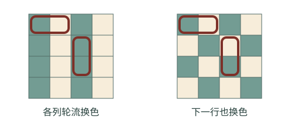

# 少两格后，面积还够不够说明铺得满？

在一张还没有涂色的 $8\times8$ 方格纸上，剪掉左上角和右下角各一格。手头有三十一块 $1\times2$ 的骨牌，允许横放、竖放，能否把剩下的纸恰好铺满？数面积，双方都是六十二格。试着全横放，第一行剩七格，会剩下一格；改成一张横一张竖，也许还有机会。一次试摆失败，只排除了一种摆法。

面积好数，是因为无论摆法，每块牌都取走两格。能不能记得比“两格”更细，又仍然让每一块牌取走同样的东西？试先给奇数列涂深色，偶数列留浅色。这样横牌总取走一深一浅，似乎有戏。把手里那块牌原地转九十度试试：竖牌却可能一次取走两格深色。坏在什么地方已经很清楚了。要让竖着的牌也一深一浅，**下一行得把上一行的颜色全部反过来**。保住横向交替，再满足纵向交替，一张棋盘的涂法就自己长出来了。

把行、列都从一编号，格子的颜色由两个编号之和的奇偶决定。每走到相邻格子，恰有一个编号改变一，所以两种放法都要盖一深一浅。完整棋盘两色各三十二格。剪下的 $(1,1)$ 和 $(8,8)$ 编号和都是偶数，两格同色；剩下的一色只有三十格，另一色却有三十二格。若真能放下三十一块牌，两色都该恰好用去三十一格。矛盾。这一次排除的是**所有摆法**，因为我们数的是每块合法骨牌都必须满足的条件。

若改剪第一行最左端相邻的两格，第一行剩下六格可以横铺，其他各行照样横铺，确实铺得满。不过一般区域里，两色数相等仍不充分，例如只余互不相邻的一深一浅两个单格。把每一格看作顶点，相邻格之间连边，骨牌要铺满，等价于选出一组边，使每个顶点恰好用一次。这就把染色的必要条件接到[二分图中的完美匹配](../oly-graph/matching.md)，后者还能检查“数量够，够得着吗”。
