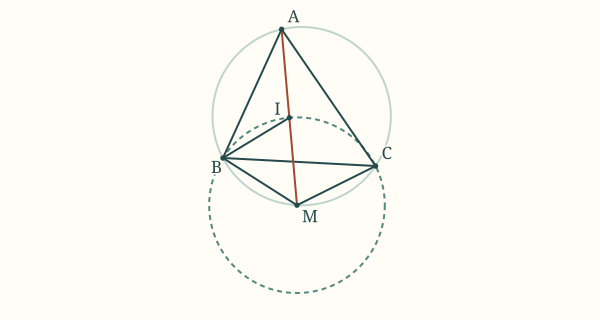

# 角平分线穿过内心以后，为什么能找到三个等距点？

在三角形 $ABC$ 外接圆上，取不含 $A$ 的弧 $BC$ 的中点 $M$。它到 $B,C$ 等距很容易理解：两段相等的弧给出相等的弦。让人意外的是，若 $I$ 是内心，圆规以 $M$ 为针尖，扫过 $B,C$ 时也会经过 $I$。

沿 $AM$ 看，两段相等弧给出 $\angle BAM=\angle MAC=A/2$，因此 $A,I,M$ 共线，$I$ 位于 $A,M$ 之间。为了判断 $MI=MB$，考察三角形 $BMI$ 的底角。在 $I$ 处，$\angle BIM$ 是 $\triangle ABI$ 的外角，等于 $A/2+B/2$。在 $B$ 处，$BC$ 位于射线 $BI,BM$ 之间，$\angle IBM=B/2+\angle CBM$。而 $\angle CBM$ 看弧 $CM$，与 $\angle CAM$ 相等，也就是 $A/2$。两底角果然相等。

**弧中点先用相等的弧确定方向，再用外角把内心也纳入同一个距离。** 例如若 $A=60^\circ,B=50^\circ$，刚才求出的两个底角都为 $55^\circ$。得到 $MB=MC=MI$ 后，还能反过来把 $M$ 识别为三角形 $BIC$ 的外心。换到含 $A$ 的那段弧的中点，$A,I,M$ 的这一顺序和方向便失去依据。
