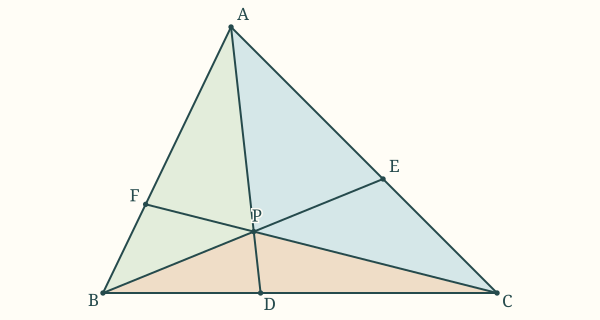

# 两条线已经相交，第三条该落在边上的哪里？

$D,E$ 分别在三角形 $ABC$ 的边 $BC,CA$ 内部，$AD,BE$ 交于 $P$。已知 $BD:DC=2:3$，$CE:EA=3:4$，从 $C$ 拉直线经过 $P$，它在 $AB$ 上截出的 $AF:FB$ 是多少？只凭图形，三个分点之间没什么直接联系。三条线共有的点 $P$ 却给了我们三个可以共用的量。

把 $[PBC],[PCA],[PAB]$ 记为 $x,y,z$。为什么 $BD/DC=z/y$？三角形 $ABD,ACD$ 的面积之比是 $BD/DC$，$PBD,PCD$ 的面积之比也是它。前一对分别减去后一对，留下的 $ABP,ACP$ 自然仍保持这个比。轮换顶点，同理有 $CE/EA=x/z$、$AF/FB=y/x$。于是
$$
\frac{BD}{DC}\frac{CE}{EA}\frac{AF}{FB}=1 .
$$
本题最后一个比是 $2$，所以 $F$ 在从 $A$ 出发三分之二处。**三个边比看似独立；共点使每个比都能改写成同一组三块面积的比。**

反过来，若先给三个内分点且乘积为 $1$，取前两线交点 $P$，把 $CP$ 真正截出的点叫 $F'$。刚证的乘积强迫 $AF'/F'B=AF/FB$。一条边内部按给定正比只能分一次，所以 $F'=F$，三线共点。这里先限三个内分点，延长线上的版本要追踪有向比，并把平行情形另作处理。
