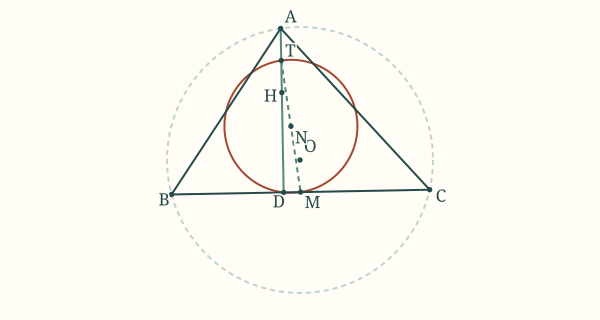

# 边中点和高的垂足为什么会挤在同一个圆上？

先放进最容易找到的三个点：三边中点。它们形成的三角形与原图相似，外接圆的半径应为原来的 $R/2$。难的是怎样把三个垂足也放进去。以外心为原点，沿用[三高共点](centers.md)中 $h=a+b+c$、$g=h/3$。这马上给出 $O,G,H$ 共线和 $OG:GH=1:2$（$O\ne H$ 时），这条线称欧拉线。

试将外接圆以 $H$ 为中心缩成一半。原来圆上任意 $X$ 送到 $HX$ 的中点，圆心变成 $OH$ 的中点 $N$。于是三线段 $HA,HB,HC$ 的中点都已在新圆上。若要 $BC$ 的中点也在其中，就须找到它的原像。中点的位置是 $(b+c)/2=(h-a)/2$，原像恰是 $A$ 的直径对点 $-a$，也在原圆上。三个边中点因此全部到齐。

取 $BC$ 的中点 $M$、$AH$ 的中点 $T$。$m=(h-a)/2,t=(h+a)/2$，故 $N$ 是 $MT$ 中点且 $MT=R$，$MT$ 是新圆的一条直径。若 $D$ 是 $A$ 在 $BC$ 上的垂足，$MD$ 沿 $BC$，$TD$ 沿高，形成直角，$D$ 也在这条直径的圆上（若与端点重合，结论直接成立）。轮换得到三个垂足。**九点圆里的九个名字，来自原圆缩小一半和直径所对的直角。** 特殊三角形中有些点会重合，等边三角形三个中心也重合，不能再由它们定出唯一欧拉线。
