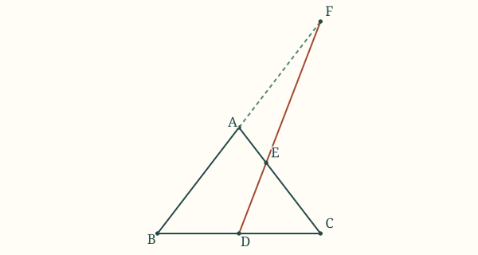

# 一根直尺如何同时约束三条边上的刻痕？

直线先后碰到三角形 $ABC$ 的三条边所在直线，交点依次记作 $D\in BC,E\in CA,F\in AB$，都不在顶点。实画一条割线就会发现，它通常截到两条边的内部，第三个交点在延长线上。无符号的边长比会把这个关键信息抹掉。

从 $A,B,C$ 到割线量**有向高** $u,v,w$，割线一侧记正，另一侧记负。沿任一直线行走时，有向高按走过的距离线性改变。比如从 $B$ 走到 $C$，在 $D$ 处从 $v$ 变到零，再从零变到 $w$，所以有向比 $BD/DC=-v/w$。同理 $CE/EA=-w/u$，$AF/FB=-u/v$。三式相乘得 $-1$，这就是梅涅劳斯定理。这里每个比例沿该边的同一坐标方向度量分子与分母。

例如 $BD/DC=1,\ CE/EA=2$，第三比只可能是 $-1/2$。在 $A=0,B=1$ 的数轴上设 $F=t$，则 $t/(1-t)=-1/2$，得 $t=-1$，确在 $A$ 外。**负号把第三个点送到了延长线上。** 反过来，两个分点确定一条直线。若此线与第三边平行，相似三角形给前两个有向比之积为 $1$，那么要求第三比为 $-1$，有限点不可能达到。否则让该线交第三边，已证关系唯一确定交点的有向比，故满足乘积条件的第三点必在割线上。
