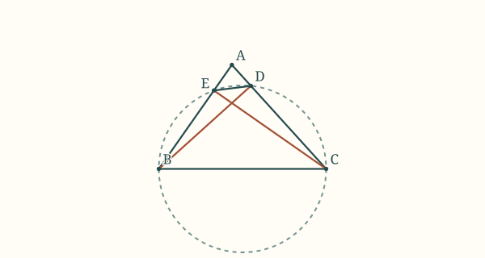

# 借共圆转移角度：两处垂足怎样帮我们找到一个角？

在锐角三角形 $ABC$ 中，从 $B$ 向 $AC$ 作垂线 $BD$，从 $C$ 向 $AB$ 作垂线 $CE$，连接两个垂足 $D,E$。已知 $\angle ABC=55^\circ$，求 $\angle BDE$。横在眼前的 $DE$ 是新连的斜线，题目没有报它与任何边的夹角。若直接追三角形 $BDE$ 的内角，手上的 $55^\circ$ 迟迟进不来。

放下所求角，先问新添的两只直角共享什么。$\angle BDC$ 的两条边连向 $B,C$，$\angle BEC$ 的两条边也连向同一对端点。因此 $D,E$ 都在以 $BC$ 为直径的圆上。这一步只用到[直角所对应的圆](right-diameter.md)，完全可以在还没想出角度怎么求时先做。

回来看 $\angle BDE$。它站在 $D$ 看的是哪条弦？两端是 $B,E$。沿同一圆找另一个可以看弦 $BE$ 的点，图里已有 $C$。由于 $D$ 在边 $AC$ 内部，而 $E$ 在边 $AB$ 内部，$D$ 和 $C$ 位于直线 $BE$ 的同一侧。于是[圆周角定理](inscribed-angle.md)允许把观察者从 $D$ 移到 $C$，$\angle BDE=\angle BCE$。在原先看不出用处的直角三角形 $BCE$ 中，$\angle CBE=55^\circ$，故 $\angle BCE=90^\circ-55^\circ=35^\circ$，这就是所求。

这个方法里有两个不同的发现。两个直角告诉我们**哪些点在同一个圆上**；所求角的两条边则告诉我们**该盯住哪一条弦**。只背一句“见垂足就作圆”仍无法决定下一步。如果换成钝角三角形，垂足可能落在边的延长线上，两个观察者所在的侧也可能改变。此时仍可以先由直角找圆，但须重新决定该取相等的角还是互补的角。
