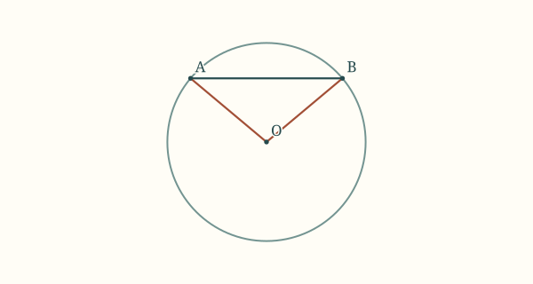

# 圆、弦与弧：一根绳子能规定什么形状？

系一根长度为 $r$ 的绳子，把一端钉在 $O$，另一端拴一支笔。拉紧后转一圈。为什么转出来的线不会多画或少画一部分？笔落下的每个点都离 $O$ 恰好 $r$；反过来，纸上任何一个与 $O$ 相距 $r$ 的点，都可以把笔转到那里。这两句话合在一起给出圆的定义：在平面中，与固定点 $O$ 距离等于固定正数 $r$ 的所有点组成圆。绳子放松后笔能到达的整个区域则是圆盘，内部的点离 $O$ 小于 $r$。

在圆上钉两根钉子 $A,B$。若用细线拉紧连接它们，得到线段 $AB$，叫作一条**弦**。若一只小虫沿着圆周从 $A$ 爬到 $B$，它却有两个方向可选。两只钉子把圆周分成了两段**弧**。遇到“弧 $AB$”不知指哪一段时，我们可以再说一个它途经的点。经过圆心的弦叫直径，它由两条相反方向的半径接成，长度是 $2r$。

怎样给弧的大小贴上一个不用拿软尺量的标记？从 $OA$ 开始，沿选定的弧转动半径，直到与 $OB$ 重合。半径转过的角度叫这段弧的**度数**。例如较小的圆心角是 $100^\circ$，一条弧是 $100^\circ$，另一条就是 $260^\circ$。把绳长加倍，转角仍是 $100^\circ$，笔走的路却更长了。因此谈弧的度数要看转了多少，谈弧的长度还要知道半径。

现在站到圆上另一个位置 $P$，回头看两根钉子。两条视线 $PA,PB$ 又形成一个角。圆心、两根钉子都没动，只有观察者变了。在[圆周角定理](inscribed-angle.md)里，弧的两种选择正是解开这个问题的关键。
