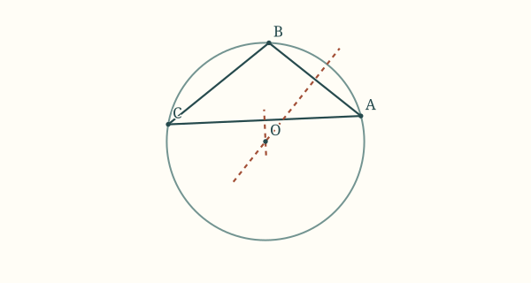

# 三点定圆：一只圆规怎样同时经过三个钉子？

桌上钉了三根钉子 $A,B,C$。若只绕过 $A,B$，合适的圆有许多。换成必须经过三个点，看起来大概只有一个，但也可能根本画不出。我们把“有一个”和“只有一个”分两步想。

先假想已经有了一个圆心 $O$。要让笔尖同时碰到 $A,B$，圆规从 $O$ 张开后不能变动，所以 $OA=OB$。这一下就把圆心的落脚范围缩到了 $AB$ 的[垂直平分线](bisector.md)上。再加 $OC=OA$，又把落脚点限制在 $AC$ 的垂直平分线上。

若 $A,B,C$ 不共线，直线 $AB,AC$ 方向不同，各转一个直角后方向仍不同，因而两条中垂线相交于唯一一点 $O$。刚才只是猜测圆心该在哪里，现在可以回头检查：交点到 $A,B$ 等距，也到 $A,C$ 等距，因此 $OA=OB=OC$。以它为圆心、取 $OA$ 为半径，的确能画出所求圆。任何满足要求的圆心都只能是这个交点，半径也随之确定。这就是三角形的**外接圆**，其圆心叫**外心**。第三条边的中垂线会自己经过 $O$。

不要预先把圆心搜寻范围缩到三角形内部。图中三个点占据圆的一侧，外心落在三角形外。若三个不同的钉子正好共线，两条中垂线则平行而不同，圆规无处落脚。这和绳子拉得不够长无关，是条件本身无解。

添第四根钉子时，能调的圆心和半径都已经用完。这就带出了另一个好问题：第四根钉子什么时候会碰巧在原来的圆上？你可以先连接几条弦，再看[四点共圆](../concyclic.md)的角度判据。
