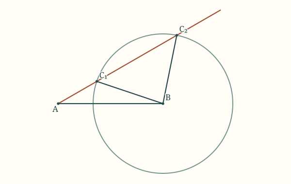

# 三角形全等判定：订一块三角板要给几项尺寸？

请木匠做一块和样板完全重合的三角板，允许翻面。你报上三只角，木匠照着角度画，却把整张图放大一倍。形状看起来对了，板子仍装不进去。我们得找一组数据，既锁住形状，又锁住大小。

先钉下一条长 $6$ 的底边 $AB$。再告诉木匠，从 $A$ 出发的第二条边与 $AB$ 成 $50^\circ$，长度是 $4$。这下 $C$ 必须在指定射线上离 $A$ 恰好 $4$ 的地方。另一面也有一个选择，但把板子沿 $AB$ 翻过来，两种做法就重合了。这就是**边角边**，给的角要夹在两条已知边之间。

同样地，若给 $AB$ 以及 $A,B$ 两处的内角，$C$ 必须同时落在两条按角度作出的射线上。只要是一个真正三角形的尺寸，射线便有唯一交点。这是**角边角**。知道两角和另一条对应边也可以，先由[内角和](triangle-angles.md)算出第三角，把已知边两端的角补齐即可。

如果只报三边，固定 $AB$ 后，还能把另外两个长度理解成两只圆规的开口。$C$ 是以 $A,B$ 为圆心的两圆交点，位于底边同一侧的交点至多一个；若另有一个，它正是翻面的结果。三边真的能围成三角形还要满足较短两边之和大于最长边。等于时三点会压在一条线上。由此得到**边边边**。

把“夹角”换成其中一条边的对角，会怎样？令 $AB=6$，在 $A$ 画与 $AB$ 成 $30^\circ$ 的射线，要求 $BC=4$。从 $B$ 到这条射线的垂距是 $3$（$30^\circ$ 直角三角形的短边为斜边的一半）。圆心 $B$ 到射线的距离小于半径 $4$，而射线起点 $A$ 又在圆外。垂足落在射线前方，因此射线先进入圆再穿出去，有两个顶点 $C_1,C_2$ 可选。两条 $AC$ 长度不同，三角板真的有两种大小形状。这个失败恰好告诉我们，为什么报尺寸时不能只数“我已经说了三个数”。

直角三角形有个例外很实用。给定一条直角边和斜边，另一条直角边沿已知边端点的垂线伸出，离对端的距离从这条已知直角边长起严格增加，达到指定斜边长时位置就确定了；也可由[勾股定理](pythagoras.md)求出另一条边再用边边边。比较两幅图时记得先确定哪个顶点对应哪个顶点，配错边时，上述构造不会描述同一块板。
