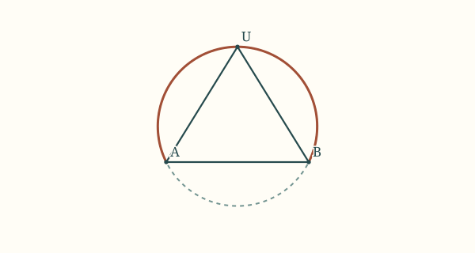

# 定角所见弦的轨迹：所有合适的座位都找到了吗？

一个舞台的两头是 $A,B$。我们想在直线 $AB$ 的**指定一侧**安排一排座位，每个座位看舞台的开口都等于给定角 $\alpha$，其中 $0^\circ<\alpha<180^\circ$。若恰好想看直角，答案是以 $AB$ 为直径的一段半圆。换成 $55^\circ$ 或 $130^\circ$，哪一排才对？

先找最对称的座位 $U$，让 $UA=UB$。此时两底角都得是 $(180^\circ-\alpha)/2$。从 $A$ 和 $B$ 向指定半平面分别画出这两个角，两条射线有唯一交点。这就有了第一个肯定合适的位置，也避免了凭感觉调整圆规的开口。

经过 $A,U,B$ 画出[唯一的外接圆](circumcircle.md)。它在指定一侧的开弧经过 $U$。在这段弧上任取 $P$，$\angle APB$ 和 $\angle AUB$ 截的是同一条对侧弧，[圆周角定理](inscribed-angle.md)保证二者相等。注意，即使 $\alpha$ 很大，取的仍是 $U$ 所在一侧的那段弧，不能机械地选长弧或短弧。

还须排除圈外的座位。设 $P$ 也在指定侧并量得 $\alpha$，先给它单独画出圆 $ABP$。在这个新圆上，取 $P$ 所在那段 $AB$ 弧的中点 $V$。这个点到 $A,B$ 等距，因为将图沿弦的中垂线翻折会交换 $A,B$ 并保持该段弧。$V$ 和 $P$ 还看着同一段对侧弧，所以 $\angle AVB=\alpha$。因此 $V$ 必是我们最先确定的、唯一的等腰座位 $U$。两个圆现在都经过 $A,U,B$，它们原来就是同一个圆。

这个“先找一排，再证明没漏”的过程给出了完整轨迹。端点 $A,B$ 不计入，那里没有可量的角。若把两侧位置都允许进来，还应该添上这段开弧关于 $AB$ 的镜像；两段弧一般属于不同的圆，只有 $\alpha=90^\circ$ 时会拼成同一个直径圆（仍少两个端点）。[四点共圆的逆向判断](../concyclic.md)正要用到这里的“没漏”。
