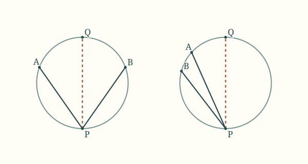

# 圆周角定理：沿看台换座位，球门看起来多宽？

把球门的两根柱子记作 $A,B$，几排座位恰好沿一条经过这两点的圆弧排列。一名观众在 $P$ 处，看球门的开口是 $\angle APB$。换座位后，人到两根门柱的距离会变，一根变近、另一根变远。有没有一种量，却能从开场一直保持到散场？

连 $OA,OB$，其中 $O$ 是圆心。现在弦 $AB$ 对应两段弧。观众两条视线张开，朝球门望去，眼前截到的是那段**不含 $P$** 的弧。我们来比较这段弧的度数和眼睛处的张角。先找一个容易算的座位，让一条视线 $PA$ 经过圆心，于是 $PA$ 是直径。连 $OB$，则 $OP=OB$，$\triangle OPB$ 的两底角均为 $x=\angle APB$。在 $O$ 处把 $PO$ 延长到 $A$，$\angle AOB$ 是这个三角形的[外角](triangle-angles.md)，等于 $x+x$。这个角正好量出不含 $P$ 的弧 $AB$，所以观众只看到了它的一半。

任意座位 $P$ 未必这样方便，但永远可以画一条从 $P$ 通到圆对面的直径 $PQ$。刚才的一半关系可分别用在 $\angle APQ$ 和 $\angle QPB$ 上。若射线 $PQ$ 位于两条视线之间，弧 $AQ$ 和 $QB$ 正好首尾相接，拼成不含 $P$ 的弧 $AB$；两个圆周角也正好相加，倍数关系仍然成立。若 $PA,PB$ 落在直径的同一边，两条从 $Q$ 量起且不经过 $P$ 的弧一长一短。小弧被大弧包含，差就是需要的弧，$P$ 处夹角也由大角减小角得到。若一边恰与直径重合，就已经回到第一种特殊情形。

因此，只要 $A,B,P$ 是圆上三个不同点，$\angle APB$ 就等于不含 $P$ 的弧 $AB$ 度数的一半。如果这段弧有 $246^\circ$，观众张角是 $123^\circ$。若只看通常标作小角的 $\angle AOB=114^\circ$ 再除二，就会误算成 $57^\circ$。那是从弦另一侧观望时的角。

现在，“换座位角度不变”有了精确范围。在 $AB$ 所分出的一段开弧上换座位，所截的始终是另一段弧，角度确实不变。跨到对面去，两弧加起来是 $360^\circ$，两种观测角就互补。由此还可以反过来追问，是不是所有看出同一角度的位置都在圆弧上？[定角所见弦的轨迹](fixed-angle.md)
