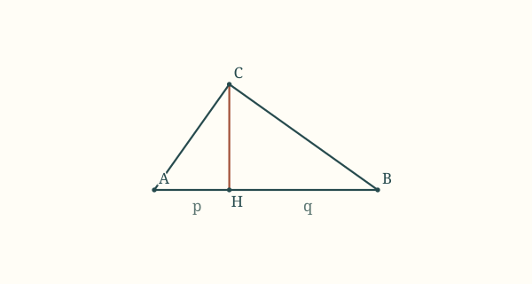

# 勾股定理：斜边上的一刀为什么会生出平方？

一块长方形的地面长 $4$、宽 $3$。从一个角走到对角，沿边绕过去是 $7$，直走显然短一些。假设把两条直角边都扩大两倍，斜边也应该跟着扩大两倍。于是先猜“两个长度相加再乘某个常数”，似乎挺像那么回事。可形状变了呢？需要找一种关系，能自己照顾不同的长宽比。

取直角三角形 $ABC$，直角在 $C$，斜边 $AB=c$。从 $C$ 到斜边作垂线，垂足为 $H$，设 $AH=p, HB=q$。这一刀的好处在于，$\triangle ACH$ 有一只直角，又和原三角形共用角 $A$。因此它是原三角形的[相似](similarity.md)缩影。同样，$\triangle BCH$ 与原三角形也相似。

把对应边认真配一次。在靠 $A$ 的小三角形里，斜边是 $AC$，对应大三角形的斜边 $AB$；挨着角 $A$ 的直角边是 $AH$，对应大三角形的 $AC$。因此
$$
\frac{AH}{AC}=\frac{AC}{AB},\qquad AC^2=cp.
$$
从 $B$ 那一头得到 $BC^2=cq$。把两个平方放在一起，它们恰好填满同一个 $c$ 乘上两段之和：
$$
AC^2+BC^2=c(p+q)=c^2.
$$
**两个平方来自相似比例里同一条边出现了两次**。回到地面，斜边长应为 $\sqrt{3^2+4^2}=5$，这和沿边走的 $7$ 是两种不同路线的长度。

反过来也可以用绳长检查直角。给定一个三角形，若两短边长 $a,b$ 满足 $a^2+b^2=c^2$，另画一个两直角边为 $a,b$ 的直角三角形。刚证明的关系使它的斜边恰为 $c$。它与原来的三角形三边分别相等，故[全等](congruence.md)，原图的该角也为直角。若只知道一个普通三角形有两条边长 $3,4$，夹角却能活动，第三条边就没有理由固定为 $5$。
