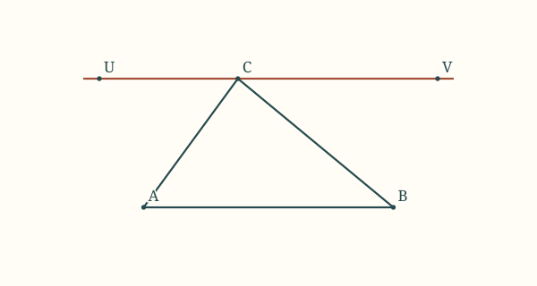

# 三角形内角和与外角：把三只角搬到同一个顶点

剪下一个纸三角形，把三个角剪开再拼起来，似乎总能拼成一条直线。可是纸边有宽度，很瘦的三角形尤其难拼准。我们想找一条理由，它也能管住从没剪过的那无数个三角形。

在欧氏平面里画一个三角形 $ABC$。角 $C$ 已在手边。**若能把另外两个角搬到同一个顶点，就能把拼纸变成证明**。角 $A$ 的一边是 $AC$，直线 $AC$ 已经通往 $C$，所缺的只是那里一条与 $AB$ 同方向的边。因此，过 $C$ 作 $AB$ 的平行线，从左到右标作 $U,C,V$，令 $CU$ 与 $BA$ 同向。

以 $AC$ 作截线，由[内错角相等](parallel-angles.md)，$\angle UCA=\angle CAB$。同样以 $BC$ 作截线，$\angle BCV=\angle ABC$。沿三角形所在一侧从 $CU$ 转到 $CV$，恰好依次经过射线 $CA,CB$，这三个角不重叠也不留缝。于是
$$
\angle CAB+\angle ACB+\angle ABC=180^\circ .
$$

例如已知两角为 $47^\circ$ 和 $68^\circ$，第三角只能是 $65^\circ$。这里也有一个检验办法：如果量得的三个内角中有两个都是直角或钝角，就无法给第三角留下正的角度。

把 $AB$ 穿过 $B$ 向外延长到 $D$，新出现的 $\angle CBD$ 是顶点 $B$ 的一个外角。它和内角 $\angle ABC$ 拼满 $180^\circ$。刚才搬过来的另外两个内角之和也占同样多，所以 $\angle CBD=\angle BAC+\angle ACB$。以后我们碰到由两条半径围成的等腰三角形时，一个外角就能把那两只相等的底角同时数进去。
