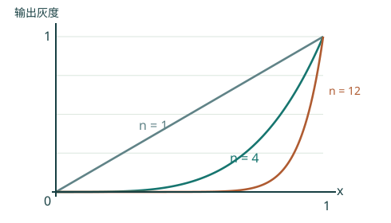

# 逐点逼近为什么可能产生不连续的极限

考察定义在 $[0,1]$ 上的函数序列 $f_n(x)=x^n$。固定 $x=1/2$ 时，函数值按几何级数的速度下降。若换成 $x=0.99$，下降较慢，极限是否改变？对每个固定的 $0<x<1$，写 $x=1/(1+a)$，其中 $a>0$。由 $(1+a)^n\ge1+na$ 得 $0<x^n\le1/(1+na)$，右边趋于零，所以极限相同。端点 $x=0$ 的值恒为零；$x=1$ 的值则恒为一。

先钉住一个位置，再看这个位置上的数列，便得到**逐点收敛**。精确地说，对于每个 $x$ 和每个 $\varepsilon>0$，存在可依赖 $x,\varepsilon$ 的 $N$，使 $n\ge N$ 时 $|f_n(x)-f(x)|<\varepsilon$。本例的极限图在 $[0,1)$ 上为零，端点取一。每一版曲线都连续，最终图却出现了跳跃。

上面的证明先固定了 $x$。要让整个区间上的误差都小于 $1/2$，能否事先选取一个共同的 $n$？对任意给定的 $n$，取 $x=(3/4)^{1/n}<1$。该点的极限值为零，这一项的值却是 $3/4$。增大 $n$ 后仍可以按同一规则找到新的反例。**逐点收敛允许所需下标随位置而变，这正是它在此处无法控制整个区间误差的原因。** 如果限制到 $[0,0.9]$，则有对所有 $x$ 同时有效的上界 $0.9^n$。这个区别引出了将连续性[传给极限](../../../../chapters/analysis/uniform-limit.md)的条件。
