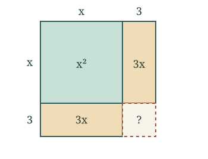

# 为何要补上一次项系数一半的平方？

若要从 $x^2+6x$ 直接读出最小值，单独估计两项并不容易：平方总是非负，一次项却能取负值。能否将两项同时纳入一个平方？取 $x>0$，把面积为 $6x$ 的长方形分为两条宽三的长条，分别排在边长为 $x$ 的正方形的两条相邻边上。现在离一个完整正方形只差一个角。

缺角面积是九。补进去再扣回来，面积就写成
$$
x^2+6x=(x+3)^2-9.
$$
这次原图只解释了 $x>0$ 的情形。把右边展开，得 $x^2+6x+9-9$，说明这条等式对负的 $x$ 和零也成立。这种把二次项和一次项收进同一个平方的改写，叫**配方**。

如果宽度改了，能不能还照样补九？展开 $(x+t)^2=x^2+2tx+t^2$，其中两条长条各贡献 $tx$。若手头是 $x^2+bx$，就只能取 $2t=b$，所以要补的是 $(b/2)^2$。**一次项前面若是负号，这个 $t$ 就是负数**；图不必画成负宽，展开仍把改写验证得很清楚。

这样的改写值得做，是因为平方在实数里不会小于零。例如 $2x^2-8x+11$，先从前两项提出二，再配一次方：
$$
2(x^2-4x)+11=2\bigl((x-2)^2-4\bigr)+11=2(x-2)^2+3 .
$$
立刻看出它在实数上至少为三，而且 $x=2$ 真能达到三。如果问题要求 $x\ge4$，则 $x-2\ge2$，最小值要在 $x=4$ 取得，等于十一。平方本身的最低点和题目允许到达的位置，要一起检查。

还可以倒过来问这个式子何时等于五。配好方后，只剩 $(x-2)^2=1$，故 $x=1$ 或 $3$。同一次改写，一头连到[二次方程的根](quadratic-roots.md)，另一头连到[图像的顶点](../../../../chapters/elementary/quadratic-graph.md)。
