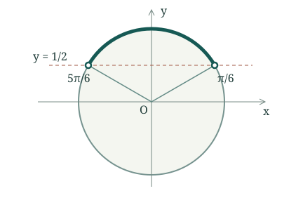

# 在单位圆上确定不等式的整个解集

一枚标记在半径为一的圆上逆时针匀速转动。以最右点为起点，转过 $x$ 弧度，标记高度是 $\sin x$。问高度超过一半的所有时刻。只算出 $\arcsin(1/2)=\pi/6$，很容易说「转得超过 $\pi/6$ 就够了」。转到正左边时试试，高度已经回到零。这一次判断失手，是因为在上升的半段和下降的半段，同一个高度都会遇到。

先取一圈 $0\le x<2\pi$。在图上画 $y=1/2$，交点的横坐标 $u$ 满足 $u^2+(1/2)^2=1$，解得 $\pm\sqrt3/2$。两个交点分别对应角 $\pi/6$ 与 $5\pi/6$。从右边的交点继续转，先经过最高点，再从左边的交点离开。因此恰好在这段开弧上符合要求。**先在一圈中圈出满足条件的整段弧，再用周期把所有圈找回来。** 答案是
$$
\pi/6+2k\pi<x<5\pi/6+2k\pi,\qquad k\in\mathbb Z .
$$

若改为「至少一半」，两个端点都符合，应把两端都包括进去。

再问横坐标大于 $1/2$ 的时段。画竖线后，最右点恰好落在所求弧的中间。写成 $-\pi/3+2k\pi<x<\pi/3+2k\pi$ 就很简短。在 $[0,2\pi)$ 里，同一段弧被起点切成 $[0,\pi/3)$ 与 $(5\pi/3,2\pi)$ 两段。选择从哪里起数可以改变答案写成几段，却不能添上或漏掉一个位置。[主值](inverse-trig.md)负责找一处边界，弧的哪一侧满足条件还须亲自检查。
