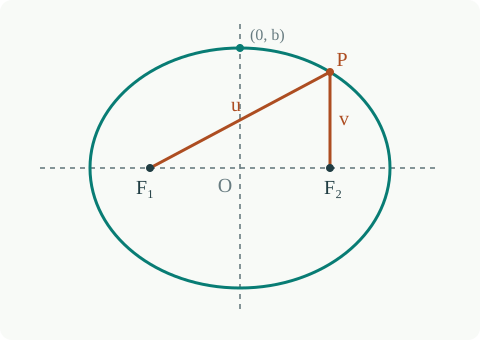

# 到两个定点的距离和固定，会得到怎样的曲线？

圆由到一个定点的距离确定。换成两个不同的定点 $F_1,F_2$，若分别规定两段距离，两圆通常只交于有限个点。为了让点仍能沿曲线移动，可以只固定两段距离的和。这个选择也可以从一个作图问题得到。把一根定长细线的两端分别固定在 $F_1,F_2$，让第三点 $P$ 将它绷紧。移动 $P$，观察线被分出的两段：第一段增加多少，第二段就要减少多少。若线是松的，这两段直线距离之和还可以小于绳长，画出的就不只是一条边界。因此“绷紧”对应条件里的等号。

记 $F_1F_2=2c$，距离和为 $2a$。从 $F_1$ 经 $P$ 到 $F_2$ 的折线，不能比直接连接两焦点更短，这便是这里用到的三角不等式 $PF_1+PF_2\ge 2c$。因此 $a<c$ 时没有这样的点，$a=c$ 时只能落在焦点之间的线段上。取 $a>c>0$，满足 $PF_1+PF_2=2a$ 的全部点称为**椭圆**，两定点称为**焦点**。

先在图上沿 $F_1P$ 到 $P$ 再沿 $PF_2$ 到 $F_2$，两个长度标为 $u,v$。若将 $P$ 移到最上方的 $(0,b)$，它处在两焦点正中间上方，这时才有 $u=v$。在一般位置只能把两段的和当作已知。适合的坐标轴也可以从这个条件本身找出。关于焦点连线反射，两焦点固定，距离和不变。关于其中垂线反射，两距离互换，和也不变。于是取两焦点的中点为原点，连线为横轴，可写 $F_1=(-c,0), F_2=(c,0)$。

先求轴上的点。在右焦点右侧，两距离之和为 $(x+c)+(x-c)=2x$，于是 $(a,0)$ 是一个交点。在正纵轴上两距离相等，各为 $a$。若交点高度为 $b$，勾股定理给出 $b^2=a^2-c^2$。其余点的两段距离各含一个根号，直接把和平方会产生根号乘积。能否利用已知的和先消去一个距离？

将 $PF_1,PF_2$ 分别记作 $u,v$。从坐标算距离平方，再作差，恰好消掉两个 $y^2$，得到
$$
u^2-v^2=(x+c)^2-(x-c)^2=4cx.
$$
而 $u^2-v^2=(u+v)(u-v)$，我们恰好知道其中一个因子 $u+v=2a$。所以 $u-v=2cx/a$，从而 $v=a-cx/a$。用 $v^2=(x-c)^2+y^2$，展开两边、约去 $-2cx$，得到
$$
\left(1-\frac{c^2}{a^2}\right)x^2+y^2=a^2-c^2.
$$
记住 $b^2=a^2-c^2$，再除以 $b^2$，就是
$$
\frac{x^2}{a^2}+\frac{y^2}{b^2}=1.
$$

方程左边的两项都非负，因此 $|x|\le a,\ |y|\le b$。根据对称性，$(\pm a,0),(0,\pm b)$ 都能达到，$a,b$ 分别给出长、短半轴长。

推导中用过平方，还要检查其逆向。由 $|x|\le a$ 知 $a+cx/a$、$a-cx/a$ 都至少为 $a-c>0$。例如由方程写出 $y^2=b^2(1-x^2/a^2)$，代入 $(x-c)^2+y^2$，再用 $b^2=a^2-c^2$，结果正是 $(a-cx/a)^2$。同理 $(x+c)^2+y^2=(a+cx/a)^2$。刚才的正号检查使得开方后可以还原两段实际距离，它们的和正好是 $2a$。**这一步保证方程给出的每个点都满足原距离条件。**

例如 $2c=6,2a=10$ 时 $c=3,a=5,b=4$。点 $(0,4)$ 到两焦点的距离各为 $5$，而 $(5,0)$ 的两段距离为 $8$ 和 $2$。两点到原点的距离不同，到焦点的距离和却相同。当保持 $a$ 并让 $c$ 趋于零，短半轴 $b$ 趋于 $a$。焦点重合时，原条件恰好化为到共同中心的距离等于 $a$，得到圆。
