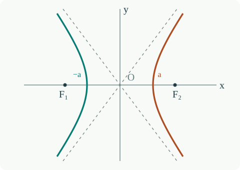

# 为什么两个信号的时间差会画出双曲线？

两个站点 $F_1,F_2$ 同时发出信号，以相同速度 $v$ 沿直线传播。接收器未必知道发射时刻，却能测出两次到达的时间差 $\Delta t$。只凭这个差值，接收器可能位于哪里？

设接收位置为 $P$，到两站的距离分别记作 $d_1=PF_1,d_2=PF_2$。若第二个信号先到，则 $d_1-d_2=v\Delta t$。于是一个可以直接测出的量给出了对位置的几何约束，而无须知道任一段距离的绝对值。

先想想能报出多大的差。假定两站相距 $2c$，从 $P$ 先到近站再绕到远站，总不会比直达远站更短。于是远站距离最多比近站距离多 $2c$。

差为零时，$P$ 在两站连线的中垂线上。差的绝对值正好是 $2c$ 时，绕经近站与直达远站恰好一样长，三个点必须在一条直线上，且近站位于途中。于是 $P$ 只能在从两站分别向外延伸的两条射线上，端点也包括在内。

记距离差的绝对值为 $2a$，并取 $0<a<c$。保留差值的大小、暂不区分先后顺序，就得到条件

$$
|d_1-d_2|=2a.
$$

满足此条件的点称为**双曲线**，$F_1,F_2$ 是它的焦点。右支到 $F_2$ 更近，左支到 $F_1$ 更近。已知信号到达的先后顺序时，就能确定所取的分支。

## 从距离差怎样找到坐标方程？

以两站的中点作原点，让 $F_1=(-c,0)$、$F_2=(c,0)$，接收器的位置写成 $(x,y)$。只看右支，这时 $d_1-d_2=2a$。直接给这个差平方会冒出两段距离的乘积，两个根号仍然缠在一起。

如同推导[椭圆](analytic-ellipse.md)的方程，可以先计算两个距离的平方。它们有一个值得利用的共同项。

$$
\begin{aligned}
d_1^2 &= (x+c)^2+y^2,\\
d_2^2 &= (x-c)^2+y^2.
\end{aligned}
$$

两式作差，$y^2$ 消去，剩下 $(x+c)^2-(x-c)^2=4cx$。**我们手里已经有了距离的差，借平方差的分解就能找到原先不知道的和**。

$$
(d_1-d_2)(d_1+d_2)=4cx.
$$

第一个因子是 $2a$，所以 $d_1+d_2=2cx/a$。用和减去差，再除以二，较短的距离就单独出来了，$d_2=cx/a-a$。现在只需把这一个距离的两种写法平方，

$$
(x-c)^2+y^2=\left(\frac{cx}{a}-a\right)^2.
$$

两边的 $-2cx$ 恰好相消。把剩下的项归到两边，得到

$$
\left(\frac{c^2}{a^2}-1\right)x^2-y^2=c^2-a^2.
$$

由于 $c>a$，右边为正，记作 $b^2=c^2-a^2$。左边 $x^2$ 的系数恰好是 $b^2/a^2$。把整式除以 $b^2$，就有

$$
\frac{x^2}{a^2}-\frac{y^2}{b^2}=1.
$$

**平方以后还要检验，所得方程是否增加了不满足距离条件的点。** 方程给出 $x^2/a^2=1+y^2/b^2\ge1$，所以只能有 $x\ge a$ 或 $x\le-a$。

在右边 $x\ge a$，于是 $cx/a-a\ge c-a>0$，加号的 $cx/a+a$ 也为正。沿刚才的等式倒回去，前者的平方等于 $d_2^2$。又因 $d_1^2-d_2^2=4cx$，后者的平方正好等于 $d_1^2$。正负号都已核对，两数就是实际距离，差也确实是 $2a$。左边由镜面对称得到，两个信号的先后顺序正好相反。

## 一个时间差能确定什么？

例如站点取 $(-5,0),(5,0)$，路程差的绝对值为 $6$，则 $a=3,c=5,b=4$。在 $(3,0)$ 测量，到两站的距离分别是 $8$ 和 $2$。

另取 $(5,16/3)$，它到右焦点的距离为 $16/3$，到左焦点的距离为 $34/3$，差仍为 $6$。即使知道哪一个信号先到，也只能确定位置落在对应的一支上。定位到单独一点还需要独立的观测条件。

图上为什么画了两条斜虚线？只看右支上半段，方程给出的高度是 $y=(b/a)\sqrt{x^2-a^2}$。取越来越大的正数 $x$，根号里的 $x^2$ 越来越大，减掉的 $a^2$ 却固定。于是可以猜，用 $\sqrt{x^2}=x$ 近似这个根号，也许会越来越准。按这个猜法画出的就是直线 $y=(b/a)x$。要知道它和曲线是不是越贴越近，可以在同一横坐标上量一量两者的高度差。

$$
\frac{b}{a}\left(x-\sqrt{x^2-a^2}\right)
=\frac{ab}{x+\sqrt{x^2-a^2}}.
$$

这个等号可以把左边的括号乘除同一个正数 $x+\sqrt{x^2-a^2}$ 得到。$x$ 越来越大，右端分母也越来越大，高度差便趋向零。这样得到的线叫作**渐近线**。另一条由对称性得到，方程为 $y=-(b/a)x$。两条直线上的点代入双曲线方程，左端都等于零，因此曲线虽不断靠近，始终没有和它们相交。
