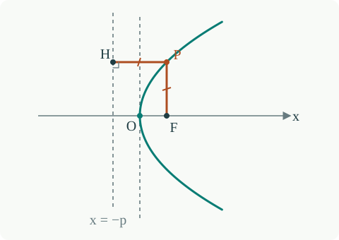

# 到一个定点和一条直线等距，为什么得到抛物线？

取一个定点 $F$ 和一条不经过它的直线 $\ell$。任取候选点 $P$，到 $F$ 的距离是线段 $PF$ 的长度，到 $\ell$ 上不同位置的距离却有许多。怎样选出只由点和直线决定的量？从该点向 $\ell$ 作垂线至 $H$，到线上其他点的线段都是以这条垂线段为直角边的斜边。因此 $PH$ 确实是点 $P$ 到整条直线的最短距离。

从 $F$ 向 $\ell$ 作垂线，在垂线段上取中点 $O$，它到两者等距。若从 $O$ 沿平行于 $\ell$ 的方向移动，与直线的距离不变，离 $F$ 却更远，等距条件随即失效。怎样找到第二个符合条件的点？与准线保持某个固定距离，允许的位置是一条与准线平行的直线；到 $F$ 保持同一距离，则允许的位置在以 $F$ 为圆心的圆上。让这个圆的半径逐渐增加，再取它与相应平行线的交点，就能逐步描出所求轨迹。坐标方程将把这整组作图写成一个条件。**到定点 $F$ 与定直线 $\ell$ 等距的点构成抛物线**，$F$ 称为焦点，$\ell$ 称为准线。

关于经过 $F$ 并垂直于准线的直线反射，焦点和准线都保持原位。因此这条垂线是抛物线的对称轴。取它为横轴，以 $O$ 为原点，正方向指向 $F$。记 $OF=p>0$，就得到焦点 $(p,0)$ 和准线 $x=-p$。

沿图中从 $P$ 到 $H$ 的线段看，$H$ 是准线上的垂足，故二者纵坐标相同。横坐标则从 $x$ 变到 $-p$，所以 $PH=|x-(-p)|=|x+p|$。这里要比较图上的斜段 $PF$ 与横段 $PH$，若误连到准线与横轴的交点，得到的通常比 $PH$ 长。去焦点则要走直线段，长度是 $\sqrt{(x-p)^2+y^2}$。**两边都是非负的长度，取平方后仍可从右式推回左式**，得到
$$
(x-p)^2+y^2=(x+p)^2
\quad\Longleftrightarrow\quad
y^2=4px .
$$
展开平方可看到，左右都有 $x^2+p^2$，约去以后是 $y^2-2px=2px$，故 $y^2=4px$。$p$ 是正数，右式立刻说明 $x\ge0$，曲线只向焦点所在的半平面张开。每个正的 $x$ 都给两种相反的 $y$，上下两点互为镜像，$O$ 是两支在对称轴上会合的顶点。若课本写 $y^2=2mx$，先找它把哪一段距离叫 $m$。我们这里 $p=OF$，整个焦点到准线的距离是 $2p$，符号差异并不会改变曲线。

取 $p=1$。横坐标为 $1$ 时，方程给 $y=2$ 或 $-2$。若取 $P=(1,2)$，到焦点 $(1,0)$ 的距离是 $2$，到直线 $x=-1$ 也是 $2$。再取 $P=(4,4)$，距焦点为 $\sqrt{3^2+4^2}=5$，直走到准线也恰好是 $5$。

把两条坐标轴的角色交换，就得到向上开口的形式 $x^2=4py$。熟悉的 $y=x^2$ 对应 $p=1/4$，故焦点为 $(0,\tfrac14)$、准线为 $y=-\tfrac14$。如果整条曲线平移，焦点和准线也作同一次平移，两段距离随之保留，所以等距条件继续成立。
