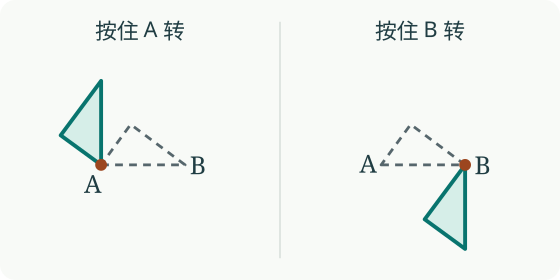

# 怎样从有限的测量判断两个图形全等？

给定两个三角形 $ABC,DEF$，希望检验它们能否完全重合。直接比较平面上每个点的位置过于严格，图形移到别处后仍然可能重合。可以先问，哪些移动保留了任意两点的距离？

尝试先使一个顶点对齐。把 $A$ 移到 $D$ 时，若只挪 $A$，边的长度就会变。让每一点都沿同一方向移动同一距离，点与点的相对位置便保持原样。这种变换称为**平移**。这样对准了一个顶点，边 $AB$ 和 $DE$ 的朝向还可能不同。固定 $D$，让每个点绕它转过同一个有方向的角，并保持到 $D$ 的距离，就得到**旋转**。只说“逆时针转 $90^\circ$”，足以让另一个人重现结果吗？图中虚线是同一个起始轮廓。左图先看 $A$，它留在原处，$B$ 转到它的正上方；右图中原地不动的却是 $B$，这次 $A$ 转到 $B$ 的正下方。**相同的转角给出不同的终点，所以必须同时指定旋转中心。**

当 $AB=DE$ 时，前两步已经能使 $A,B$ 分别重合于 $D,E$。如果 $C,F$ 分处底边两侧，还需要沿底边作一次**轴对称**。以重合的底边为轴作反射时，轴上每个点固定。对任一轴外点 $X$，先向轴作垂线至 $H$，再沿同一垂线越过 $H$ 走相同距离，得到像点。这也解释了为何轴必须给定，哪一侧交换到哪一侧由它决定。上述三种变换都保持距离和普通角的大小，轴对称还反转顶点的环绕次序。**两个图形经过这些变换可以完全重合，就称为全等。** 写 $\triangle ABC\cong\triangle DEF$ 时，字母次序指定 $A,B,C$ 的对应点分别为 $D,E,F$。因此可以读出 $AB=DE$、$\angle B=\angle E$。只知道图中某两条边等长，尚未说明它们是否是这组对应边。

三角形需要比较多少个量？只给两条相邻边的长度 $5$ 和 $3$，一边固定，另一边仍可绕公共端点转动，第三边会随夹角改变。若进一步固定这两边的夹角，先对准长 $5$ 的那条边，再据夹角确定另一条边的方向，长 $3$ 就给出其端点。镜面对称的两种位置也能重合。这个推理给出**边角边**判定，其中的角必须是已知两边的夹角。

若给定三条对应边的长度，也能使三角形重合。把底边两端放在 $(0,0),(d,0)$，$d>0$。设第三点 $(x,y)$ 离两端分别为 $r,s$。按[两点距离公式](coords.md)，
$$
r^2-s^2=x^2+y^2-\big((x-d)^2+y^2\big)=2dx-d^2.
$$
若分别用尺比较第三个点的两个距离，一开始似乎有两个未知坐标。上面选择平方后作差，正是由于两个距离中都含同一项 $y^2$。又因 $d>0$，可以除以 $2d$ 得到唯一的 $x=(r^2-s^2+d^2)/(2d)$。再由 $y^2=r^2-x^2$ 得到高度的绝对值。对于已经存在的两个三角形，第三点只能重合或关于底边对称，所以三条对应边足以判定全等，这叫**边边边**判定。

轴对称也能直接产生一个等距结论。若对称把 $P$ 送到 $Q$，则对称轴上任取一点 $M$ 都保持原位，线段 $MP$ 的像恰好是 $MQ$，故 $MP=MQ$。把这样的重合用来证明边或角相等，往往会提示该补哪条线，见[几何证明中的辅助线](plane-proof.md)。

旋转中心示例参考 [Illustrative Mathematics 刚体变换课程](https://im.kendallhunt.com/MS/students/3/1/1/index.html)。
