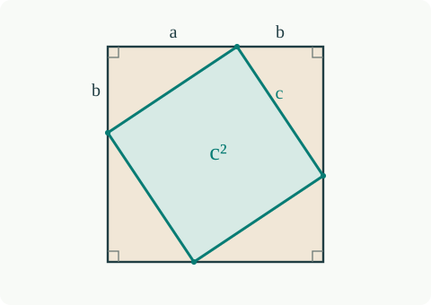

# 要用几个数才能确定平面上的一点？

为了让另一个人能复原位置 $P$，可以先说“向右三个单位”。这句话还少了两个约定，从何处算起，以及一个单位有多长。即使约好一个起点、同一条水平基线和刻度，得到的也只是一整条竖线。把点沿竖直方向移远，向下作垂线，垂足仍留在同一个刻度 $3$。这就是点在水平轴上的**垂直投影**。怎样区分投影相同的这些位置？若只补距离，水平轴上下各两个单位的两点又会混在一起，于是还得记是哪一侧。

把约好的起点记作原点 $O$。过它再取一条与水平轴垂直的轴，分别记这两轴为 $x$ 轴、$y$ 轴，通常把向右、向上定为正，两轴采用同一长度单位。这个约定构成**平面直角坐标系**。读数 $(3,-2)$ 的第一个数把点限在一条竖线上，第二个数把它限在一条横线上。两线恰有一个交点。反过来，每一点也都有唯一的一对读数。**坐标之所以能代表位置，是因为从点到数、从数到点两个方向都成立。**

数对有次序，$(-2,3)$ 确定另一个点。若把原点移到旧坐标 $(1,1)$，保持轴方向和单位，原先那个点相对新原点的横向差为 $3-1=2$，纵向差为 $-2-1=-3$，新读数就是 $(2,-3)$。因此使用坐标前必须说明参考系。

位置有了数字表示，两个位置的距离能否也用数字算出？取 $A=(-1,1),B=(2,5)$。横向相差 $3$，纵向相差 $4$。先横后纵的折线路长 $7$，$AB$ 本身却是这两段互相垂直的线段所确定的斜边。下面从已知的[面积公式](measure.md)求它的长度。

取四个相同的直角三角形，直角边长 $a,b$，斜边长 $c$。在边长 $a+b$ 的正方形四角各放一个，依次转过四分之一圈。每条外边恰好由一段 $a$ 和一段 $b$ 组成。读下图时先沿外围的一条边看，它的两段各来自哪个直角三角形。再沿中间的轮廓走一周，四段都是斜边，每段长 $c$。这还只说明四边相等；相邻三角形正好相差四分之一圈，它们的斜边也互相垂直，才可确定中间是正方形。

中间正方形的面积一方面为 $c^2$，另一方面从外围总面积中扣掉四个三角形即可得到。每个角上的三角形占 $ab/2$。外框面积展开为 $a^2+2ab+b^2$，扣掉的四块共 $2ab$，剩下的恰是 $a^2+b^2$。因此 $c^2=(a+b)^2-4ab/2=a^2+b^2$。这就是**勾股定理**。据此，前例中的距离为 $\sqrt{3^2+4^2}=5$。一般地，在上述坐标约定下，
$$
AB=\sqrt{(x_2-x_1)^2+(y_2-y_1)^2}.
$$
坐标差可以取负，平方后就是各直角边长的平方。若两轴不垂直，构造出来的三角形便不能直接用勾股定理；若两轴刻度不同，还要先把读数换成同一长度单位。由此可以把“到某点距离固定”翻译成一个坐标条件，见[曲线与方程](curves.md)。
