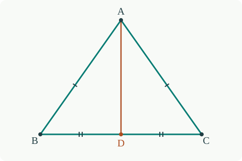

# 写几何证明时，怎样想到要画哪条辅助线？

在三角形 $ABC$ 中已知 $AB=AC$，欲证明 $\angle ABC=\angle ACB$。在若干幅图中测量底角，可以产生猜想。要得到对任意这样一个三角形都成立的结论，必须找出从两边相等走到底角相等的理由。

一个可以检验的方向是，把两个待比较的角分别放进两个三角形。任取 $BC$ 上一点 $D$ 并连 $AD$，$\triangle ABD$ 和 $\triangle ACD$ 已有 $AB=AC$，且共用 $AD$。仅有两对边还不足以判定全等，因为两边的夹角仍可改变。所缺的第三对边正是 $BD,DC$。**于是选择 $BC$ 的中点作 $D$，就有了具体的依据。**

线段有中点，所以这样选 $D$ 总能做到。三边对应相等，说明 $\triangle ABD$ 与 $\triangle ACD$ [全等](congruent.md)。重合时 $B$ 对应 $C$，$D$ 保持不动，因此 $\angle ABD=\angle ACD$。由于 $D$ 在线段 $BC$ 内，这两个角正好就是原来要比较的底角。顺着同一对应关系还能读出 $\angle BAD=\angle DAC$，而 $\angle ADB=\angle ADC$ 且两角拼成平角，各为 $90^\circ$。原来我们挑的是中线，走到最后才发现它在这个三角形里又是角平分线和高。

还能从另一项缺失的条件出发。若选 $AD$ 为顶角平分线，则 $AB=AC$、$AD$ 为公共边，两者的夹角相等，可由边角边判定全等。两种证明都只给 $D$ 一个初始条件，由此推导其余性质。如果先凭图形对称，同时写下 $BD=DC$、$AD\perp BC$ 和顶角被平分，论证就提前用了本来有待证明的事实。

这个例子的关键在于，失败的全等尝试已经指出可补的条件。另一类题中，两个待比较的角分别位于相距很远的顶点，构造全等三角形可能没有足够的边长信息。如果两角却都对着同一条线段，可以改用[四点共圆](../concyclic.md)寻找它们相等的理由。
