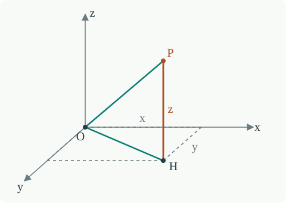

# 为什么空间里确定一个点要用三个坐标？

把空间中的点 $P$ 垂直投到同一个平面上，平面坐标给出垂足 $H$。在 $H$ 处的垂线上选取别的点，投影依旧是 $H$。还需记录一个量，使得线上每一个可能的位置恰有一个读数。

在平面中取原点 $O$ 和互相垂直的 $x,y$ 轴，再经过 $O$ 取垂直于该平面的 $z$ 轴，为各轴指定正向和相同的长度单位。用头两个坐标给出 $H$，再用 $z$ 的绝对值给出 $HP$ 的长，用符号区分位于平面哪一侧。于是**三个有次序的数 $(x,y,z)$ 唯一确定空间中的一个点**，而每个点也能如此读出坐标。

例如 $P=(3,4,2)$ 的垂足为 $H=(3,4,0)$，勾股定理给出 $OH=\sqrt{3^2+4^2}=5$。由于 $PH$ 垂直于整个 $xy$ 平面，故 $PH\perp OH$，再次应用平面勾股定理便得 $OP=\sqrt{5^2+2^2}=\sqrt{29}$。空间距离由两个有共同边的平面直角三角形算出。

从任意 $A=(x_1,y_1,z_1)$ 去 $B=(x_2,y_2,z_2)$，只须把刚才的三段换成坐标差。位移的[向量](vectors.md)就有了分量表示
$$
\overrightarrow{AB}=(x_2-x_1,\ y_2-y_1,\ z_2-z_1).
$$
若把这三项记为 $\Delta x,\Delta y,\Delta z$，直达距离为 $\sqrt{(\Delta x)^2+(\Delta y)^2+(\Delta z)^2}$。有了分量，沿向量走 $t$ 倍，就是把三个分量都乘 $t$。例如从 $A=(1,0,2)$ 到 $B=(5,2,0)$ 的中点，是从 $A$ 出发加上 $(4,2,-2)$ 的一半，落在 $(3,1,1)$。

还可以只记录什么变化被允许。从固定点 $P_0$ 沿非零向量 $\mathbf u$ 走任意实数倍，$P=P_0+t\mathbf u$ 走出整条直线。再允许沿第二个非平行向量 $\mathbf v$ 移动，$P=P_0+s\mathbf u+t\mathbf v$ 会铺满一个平面。要验证这一点，在面内分别过目标点作与两方向平行的线，就能反找出所需的两段位移。**若两向量平行，第二个方向只会带你在同一条线上来回**，这也是判定平面时要坚持选[两条不同方向](solid-parallel.md)的原因。
