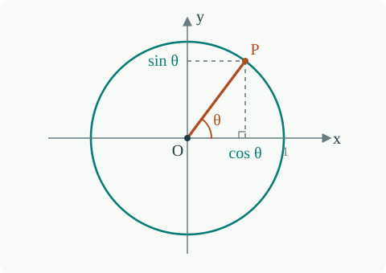

# 怎样用边长之比描述一个角？

垂直爬升 $3$ 米、水平前进 $4$ 米的一段斜坡，与爬升 $6$ 米、水平前进 $8$ 米的一段具有相同倾角。只记录高度或水平距离，都混入了坡段长度的影响。怎样构造一个只取决于倾角的量？

分别把两段补成直角三角形。它们都有一个直角，另一角都是倾角 $\theta$，由[两角判定相似](similar.md)，每一对对应边都按同一倍数改变。于是对边与邻边的比值保持不变。把这个由锐角决定的比记为它的**正切** $\tan\theta$。例中的值为 $3/4$，它直接给出单位水平距离对应的高度增量。

如果已知斜坡长度为 $20$ 米，能否用 $20\times3/4$ 求高度？上一步的分母是水平距离，现在给的是斜边长。原三角形斜边长 $5$，所以高度占斜边的 $3/5$，这次的爬升为 $20\times3/5=12$ 米。同理，水平距离占斜边的 $4/5$。把对边与斜边的比称为**正弦**，邻边与斜边的比称为**余弦**。对边指与所考察的锐角相对的边，邻边指靠着这个角的直角边。

$$
\sin\theta=\frac{\text{对边}}{\text{斜边}},\qquad
\cos\theta=\frac{\text{邻边}}{\text{斜边}},\qquad
\tan\theta=\frac{\text{对边}}{\text{邻边}}.
$$

这些定义用的是锐角和边长。转角超过 $90^\circ$ 时，水平位移可以向左，长度的正值无法记录这个变化。能否找到一种延伸，在锐角范围内又与原定义完全一致？

在直角坐标系里，从原点向右放一根长为 $1$ 的箭头，让它转过 $\theta$。约定逆时针为正，顺时针为负，端点 $P$ 始终在半径为 $1$ 的圆上。对锐角，向横轴作垂线以后，三角形的斜边是 $1$，水平位移正好是原来的余弦，竖直位移是正弦。因此对一般的有向角，也约定
$$
P=(\cos\theta,\ \sin\theta).
$$
现在转到 $150^\circ$，水平位移朝左，竖直位移向上，它是 $30^\circ$ 时端点关于纵轴的镜像。转到 $180^\circ$，端点就在 $(-1,0)$。这时候用坐标读数比重新给每个象限背一套符号更稳妥。

端点转过一整周就回到原处，因此正弦、余弦在角度增加 $360^\circ$ 后重复。端点到原点的距离恒为 $1$，所以任意角都满足 $\cos^2\theta+\sin^2\theta=1$。单位圆的纵坐标除以横坐标给出 $\tan\theta=\sin\theta/\cos\theta$，条件是 $\cos\theta\ne0$。横坐标为零时方向恰好竖直，单位水平距离对应的爬升量也失去了意义。

还可用圆弧度量转角。固定同一转角，把半径 $r$ 变成两倍，所经过的弧长 $s$ 也因图形相似而变为两倍，于是 $s/r$ 只随转角变化。称这个比为转角的**弧度数**，顺逆时针决定符号。以 $\pi$ 记圆周长与直径之比，整周的弧长为 $2\pi r$，即 $2\pi$ 弧度。因此 $180^\circ$ 对应 $\pi$ 弧度。
