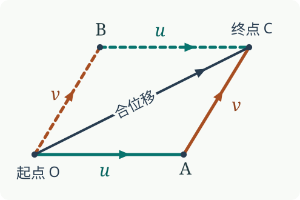

# 为什么位移可以脱离起点相加？

把一个三角形平移，在图上分别连出三个顶点的旧位置与新位置。三条连线落在不同地方，但给任何一个旧顶点同一条指令“向右三单位、向下三单位”，都能找到它的新位置。这里可以先问一个不需要坐标的问题。假如要记录的是整个平移，我们真正需要保留的是箭头从哪里出发，还是它把任意起点送向哪里？

用有向线段 $\overrightarrow{AB}$ 表示从 $A$ 到 $B$ 的移动。另一有向线段 $\overrightarrow{CD}$ 若能经过平移与它重合，就具有同样的长度和方向。**把所有这样的有向线段看作同一个位移向量，就无需为它指定起点。**

一个点给出位置，一个向量作用在这个位置上给出终点。起点与终点重合时，得到**零向量**，其长度为零，无需为它选取方向。

先做位移 $\mathbf u$，再做 $\mathbf v$。要确定两次变化的合成，把第二个位移的起点移到第一个的终点。在图中，第一步从 $O$ 到 $A$，第二步从 $A$ 到 $C$。

读图先沿实线从 $O$ 经 $A$ 到 $C$，再只看深色的对角线 $OC$。这条对角线省掉了中途位置，仍给出了恰好相同的终点。把同一整幅图平移到另一个起点，三条箭头整体移走，终点相对于起点的变化保持。无论中途经过哪里，合成位移都应把 $O$ 送到 $C$。因此定义 $\mathbf u+\mathbf v=\overrightarrow{OC}$。这个定义也说明了相加必须首尾相接的原因。

若交换次序，先沿 $\mathbf v$ 从 $O$ 到 $B$，再沿 $\mathbf u$，终点在哪里？第一条边 $OA$ 沿 $\mathbf v$ 平移后，两个端点分别变成 $B,C$，故第二步恰从 $B$ 到 $C$。两条路径构成平行四边形（共线时退化为线段），它们的合成位移相同，即

$$
\mathbf u+\mathbf v=\mathbf v+\mathbf u.
$$

向东移动 $3$ 米再向北移动 $4$ 米，经过的路程为 $7$ 米，合成位移的长度由[勾股定理](coords.md)得 $5$ 米。向南移动 $4$ 米再向西移动 $3$ 米会回到出发点，其合成位移称为前一位移的**相反向量**，两向量之和为零。

沿 $\mathbf u$ 接连移动两次，记为 $2\mathbf u$。两次相同的半程移动恰好合成 $\mathbf u$，所以把半程记作 $\tfrac12\mathbf u$。为把反向的移动也纳入同一运算，规定实数 $k$ 的绝对值确定长度的倍数，正负号确定与原向量同向或反向。$k=0$ 时得到零向量。这个运算称为**数乘**。

坐标给同一位移另一种表示。若起点为 $(1,5)$、终点为 $(4,2)$，两者坐标相减得 $(4-1,2-5)=(3,-3)$。换成从 $(-2,1)$ 到 $(1,-2)$，再相减仍得 $(3,-3)$。被消去的恰好是起点的差异。这两个数称为向量在所选坐标系里的分量。一个起点加上这两个变化量，就能恢复相应的终点。

连续两次移动时，横、纵两个方向上的变化分别累计，这就得到了分量相加的法则。旋转坐标轴会改变分量，同一对起点和终点所确定的位移仍然相同。如果一个变换保持向量相加和数乘，两支坐标单位向量的像能决定哪些信息？这通向[矩阵乘法](../matrix-multiplication.md)。
