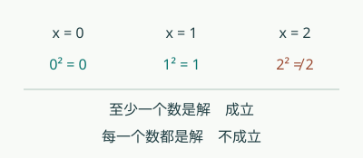

# “每一个”和“至少一个”各需要什么证据？

把 $0,1,2$ 列为方程 $x^2=x$ 的候选值。这里 $x^2$ 表示 $x$ 乘自己；一个候选值代入后，等式左右两边相等，就称它为方程的一个解。先代入 $0$，得到 $0\cdot0=0$。如果原先问的是“这三个数里有没有解”，已经可以停了。如果问的是“这三个数是不是全都是解”，只看这一步，仍不知道该回答什么。差别来自问题究竟要求保证到哪里。

暂把待检验的条件记为 $P(x)$。要在有限清单上把两问写全，第一问是“$P(0)$ 或 $P(1)$ 或 $P(2)$”，这里的“或”允许多项成立。第二问是“$P(0)$ 且 $P(1)$ 且 $P(2)$”。清单一变就得重写；如果改问每个自然数，这么列举甚至没有最后一项。再看这两串话，重复的只是同一项检验。只写一次 $P(x)$，另外写明候选范围和需要多少个对象通过，便能消去逐项点名的限制。

令 $B$ 表示候选值组成的集合，$x\in B$ 表示从其中取一个数。写在条件前面说明“至少存在一个”的符号 $\exists$，和说明“对于每一个”的符号 $\forall$，叫作**量词**。于是有两种断言：

| 写法 | 怎样读 | 什么证据可以肯定它 |
| --- | --- | --- |
| $\exists x\in B,\ P(x)$ | $B$ 中存在一个 $x$ 满足 $P(x)$ | 指出一个这样的 $x$ 并检验它 |
| $\forall x\in B,\ P(x)$ | $B$ 中每个 $x$ 都满足 $P(x)$ | 检查全部候选，或给出适用于任意成员的理由 |

第一句叫存在命题，其中一个合格的对象叫**见证**。第二句叫全称命题，只要一个范围内的对象未通过，它就有了**反例**。再代 $1$，$1\cdot1=1$，因此有两个见证了；可关于“全都是解”仍得保留判断。最后代 $2$，$2\cdot2=4$，与右边的 $2$ 不同。到这一步才能确定这三个数并非全是解。如果改用 $B=\{0,1\}$，前两次检验已经穷尽范围，全称命题便是真；先前的 $2$ 不能再用来反驳它。

“并非每个数都是解”，是否就是“每个数都不是解”？眼前的清单已经能辨明：$2$ 让前一句成立，$0$ 却使后一句失败。真正与“每个都通过”相对立的是“至少有一个未通过”。同理，要否定“至少有一个通过”，就必须让每一个都未通过。用 $\neg$ 表示否定，$\Longleftrightarrow$ 表示两边同真同假，可记为

$$
\neg(\forall x\in B,\ P(x))\Longleftrightarrow \exists x\in B,\ \neg P(x),
$$

$$
\neg(\exists x\in B,\ P(x))\Longleftrightarrow \forall x\in B,\ \neg P(x).
$$

这些约定怎样用于空清单？在空范围中既没有满足条件的成员，也没有不满足的成员。因此存在命题没有见证，是假；全称命题没有反例，是真。如果想表达“候选清单里确实有人选，而且全部合格”，应同时写出清单非空和全称条件。**只写全称量词，并没有保证所谈对象存在。**

## 先选谁，会改变什么？

两份观测记录各自可以用不止一种方法核查。假设眼前只允许方法甲、乙，第一份记录只有甲能核查，第二份只有乙能核查。那么“每份记录都有一种能核查它的方法”成立吗？给出第一份可以选甲，给出第二份可以选乙，所以成立。“存在一种能核查每份记录的方法”呢？现在得先承诺一种方法；若选甲，就无法核查第二份，选乙又无法核查第一份。两个句子使用着同一批对象、同一个条件，只调换了选择的先后。

用自然数再检验一次。对每个 $x$，存在一个比它大的 $y$，因为给出 $x$ 后取它的下一个数即可。若先指定 $y$，再要求每个 $x$ 都比它小，取 $x=y$ 就推翻了它。**“对每个 $x$，存在 $y$”允许 $y$ 随 $x$ 而变；“存在 $y$，对每个 $x$”要求固定同一个 $y$。** 读到连续几个量词时，可以从左到右问：下一次选择能够使用前面已经知道的哪些信息？

从有限个“且”“或”理解量词的写法，可参阅 Richard Hammack《Book of Proof》§2.7。[作者公开正文](https://richardhammack.github.io/BookOfProof/Main.pdf#page=65)
